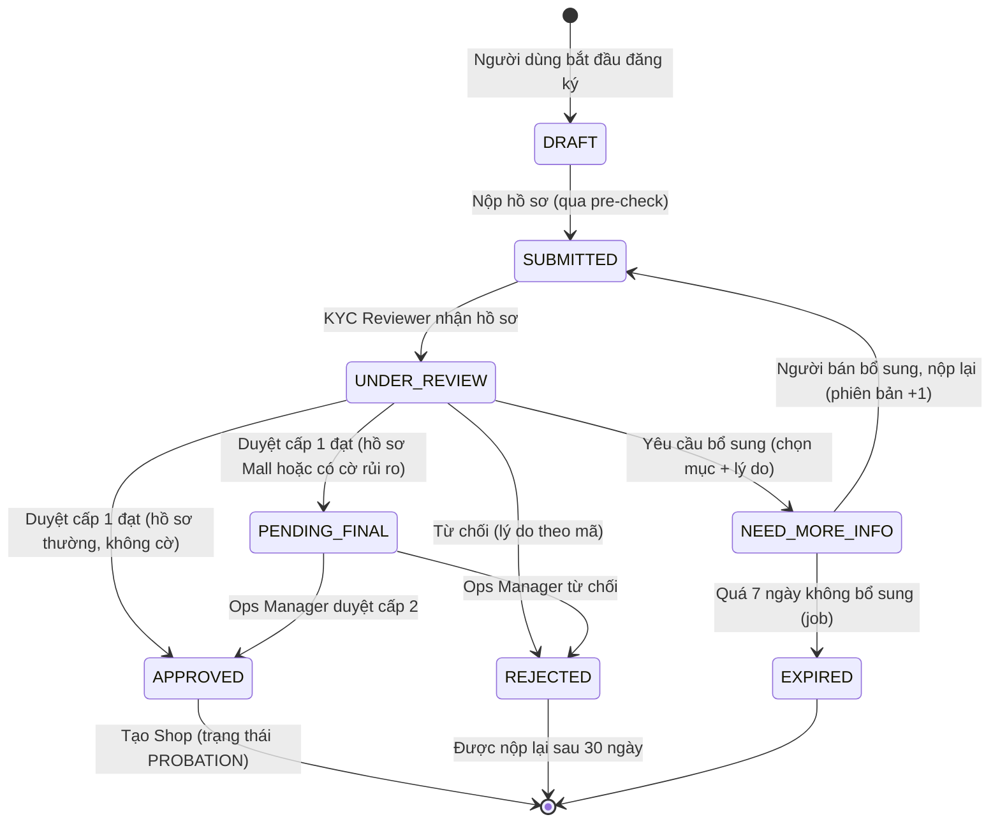
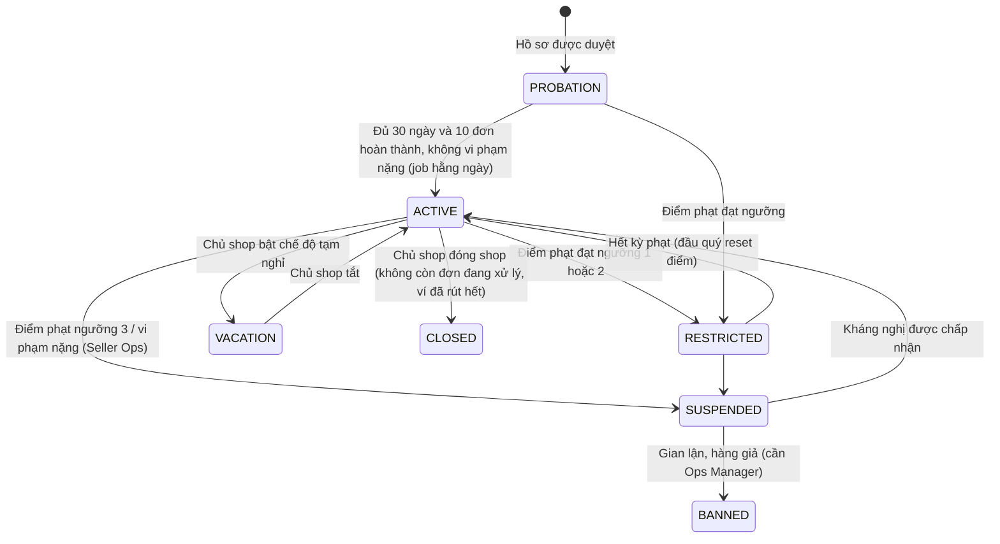
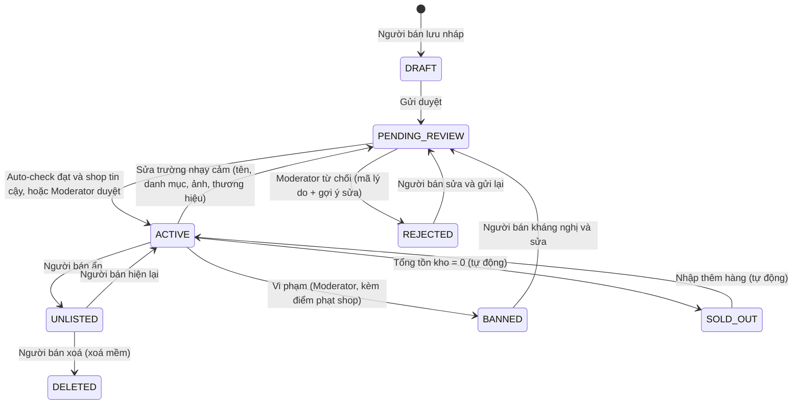
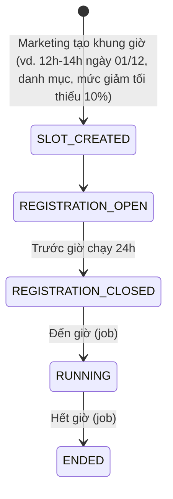
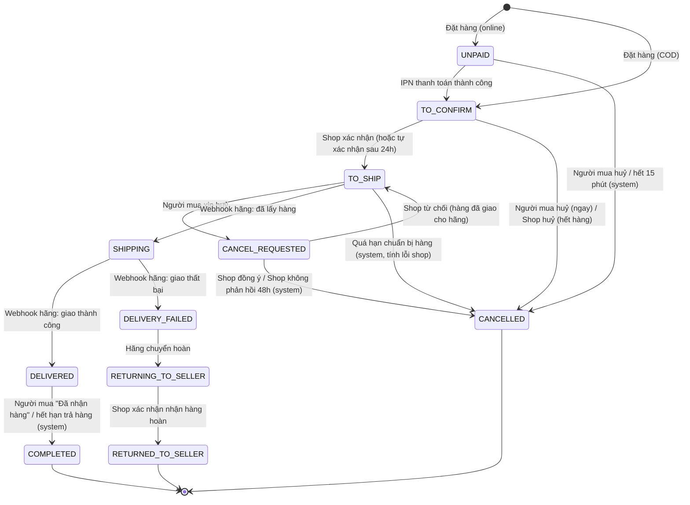
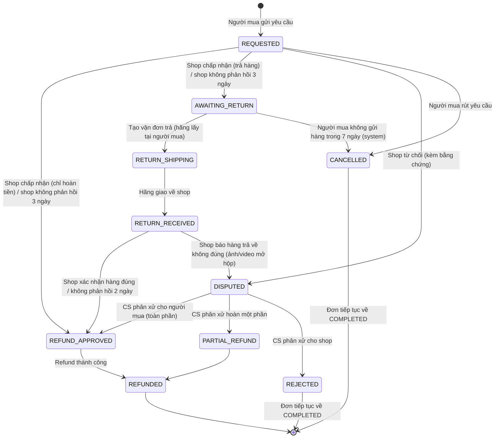
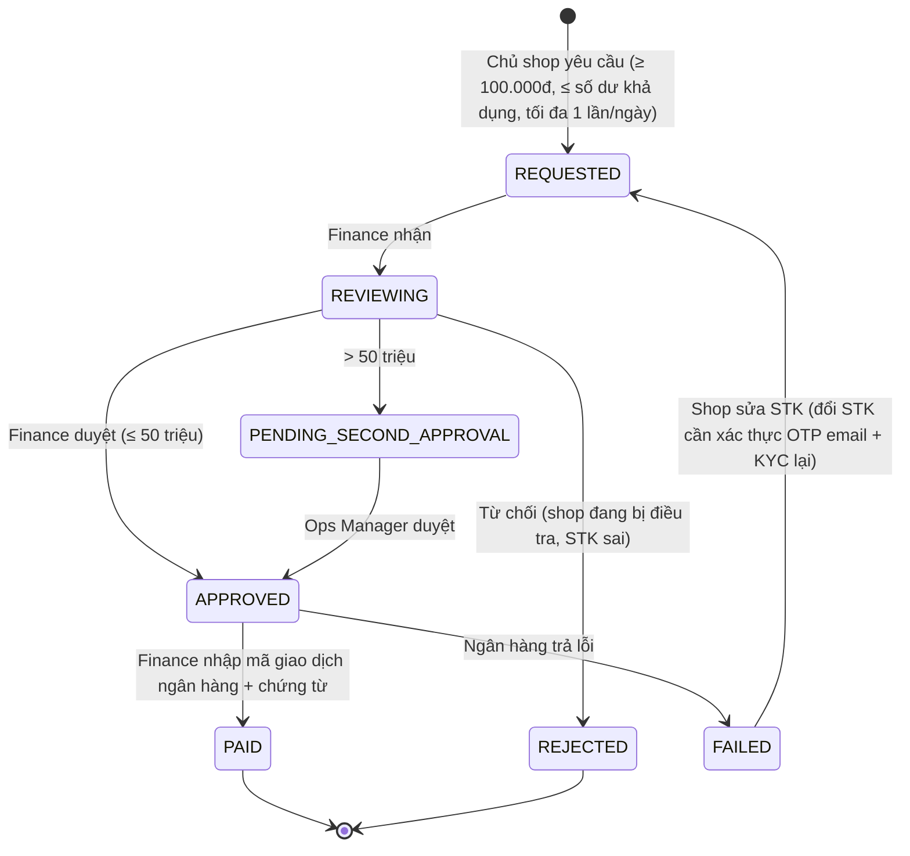
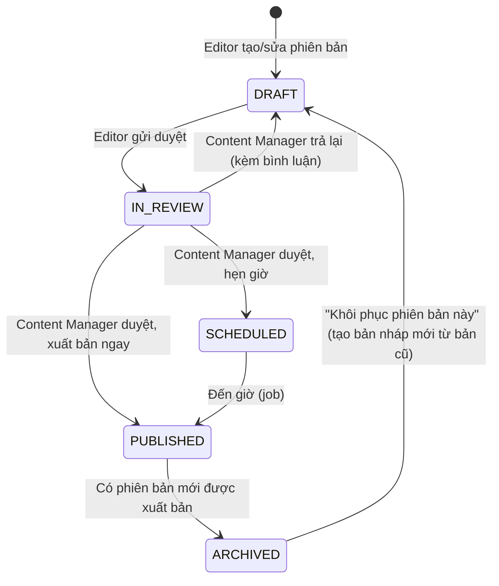
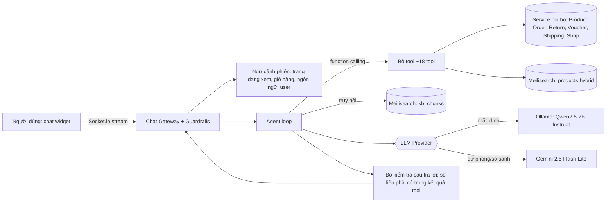

# KẾ HOẠCH NGHIỆP VỤ — NexusMart: Sàn thương mại điện tử đa nhà bán tích hợp trợ lý AI

> **Phiên bản:** 2.0 · **Cập nhật:** 18/11/2026 · Kế hoạch thống nhất của nhóm 5 thành viên.
> **Phạm vi:** file này quy định **phạm vi nghiệp vụ và phân công**, thay cho danh sách tính năng trong `docs/reference/phancong.md` (v1). Các quy ước kỹ thuật (port, cấu trúc thư mục, Git, Definition of Done) vẫn theo `docs/PROJECT_PLAN.md`.
> **Mục tiêu v2:** nâng hệ thống từ một website bán hàng nhiều người bán thành một **sàn thương mại điện tử đúng nghĩa**: có quy trình xét duyệt nhà bán, trang sản phẩm đầy đủ, đơn hàng nhiều trạng thái có thời hạn xử lý, trả hàng/hoàn tiền, dòng tiền giữ hộ, thông báo, trang chủ quản lý bằng CMS và trợ lý AI nắm dữ liệu của sàn.
> **Cơ sở xây dựng:** mã nguồn hiện tại của repo, nghiệp vụ thực tế của các sàn lớn tại Việt Nam (Shopee, Lazada, Tiki), các nền tảng thương mại phổ biến (Shopify, Adobe Commerce/Magento, SAP Commerce) và quy định pháp luật Việt Nam về thương mại điện tử.

---

## MỤC LỤC

0. [Đọc nhanh: 1 trang cho cả nhóm](#0-đọc-nhanh-1-trang-cho-cả-nhóm)
1. [Phân tích hiện trạng: khoảng cách so với một sàn TMĐT](#1-phân-tích-hiện-trạng-khoảng-cách-so-với-một-sàn-tmđt)
2. [Các mẫu thiết kế nền tảng](#2-các-mẫu-thiết-kế-nền-tảng)
3. [Nguyên tắc thiết kế nghiệp vụ v2](#3-nguyên-tắc-thiết-kế-nghiệp-vụ-v2)
4. [Tác nhân, vai trò và phân quyền (RBAC)](#4-tác-nhân-vai-trò-và-phân-quyền-rbac)
5. [Các phân hệ nghiệp vụ chi tiết](#5-các-phân-hệ-nghiệp-vụ-chi-tiết) — M1…M12
6. [Bảng tham số nghiệp vụ (cấu hình được)](#6-bảng-tham-số-nghiệp-vụ-cấu-hình-được)
7. [Trợ lý AI v2: AI cục bộ hiểu dữ liệu sàn](#7-trợ-lý-ai-v2-ai-cục-bộ-hiểu-dữ-liệu-sàn)
8. [Tech stack: thêm gì, bỏ gì, giữ gì](#8-tech-stack-thêm-gì-bỏ-gì-giữ-gì)
9. [Mô hình dữ liệu (MongoDB) v2](#9-mô-hình-dữ-liệu-mongodb-v2)
10. [Thiết kế giao diện: Storefront, Seller Center, Admin](#10-thiết-kế-giao-diện-storefront-seller-center-admin)
11. [Phân công 5 người theo phân hệ](#11-phân-công-5-người-theo-phân-hệ)
12. [Lộ trình, mức ưu tiên và phương án cắt giảm](#12-lộ-trình-mức-ưu-tiên-và-phương-án-cắt-giảm)
13. [Kiểm thử, số liệu và kịch bản demo bảo vệ](#13-kiểm-thử-số-liệu-và-kịch-bản-demo-bảo-vệ)
14. [Rủi ro và cách giảm](#14-rủi-ro-và-cách-giảm)
15. [Phụ lục: tham chiếu nghiệp vụ thực tế và pháp lý](#15-phụ-lục-tham-chiếu-nghiệp-vụ-thực-tế-và-pháp-lý)

---

## 0. Đọc nhanh: 1 trang cho cả nhóm

**Vấn đề:** hệ thống hiện tại là một **website bán hàng có thêm trường `vendor`**, chưa phải **sàn**. Một sàn thật khác ở chỗ nó phải điều phối **3 bên có lợi ích trái ngược nhau** (người mua, người bán, sàn) bằng **quy trình có trạng thái, có thời hạn (SLA), có người duyệt, có tiền giữ hộ (escrow) và có tranh chấp**.

**Hướng giải quyết v2: 12 phân hệ, mỗi phân hệ có ít nhất một quy trình nhiều bước, có trạng thái và có người duyệt:**

| # | Phân hệ | "Độ dày" nghiệp vụ thể hiện ở đâu | Người phụ trách |
|---|---|---|---|
| M1 | **Nhà bán (Seller onboarding & KYC)** | 4 loại người bán, hồ sơ 6 bước, duyệt 2 cấp, yêu cầu bổ sung, thời gian thử việc, đình chỉ/khoá | Thái |
| M2 | **Danh mục & sản phẩm** | Thuộc tính theo ngành hàng, biến thể 2 tầng (màu × size) sinh ma trận SKU, bảng size, **duyệt sản phẩm** (tự động + thủ công), vi phạm | Tài (SPU/SKU, trang chi tiết) · Tân (danh mục, thương hiệu) · Thái (thuộc tính ngành hàng, duyệt sản phẩm, sản phẩm trong Seller Center) |
| M3 | **Tìm kiếm & khám phá** | Meilisearch: gõ sai, không dấu, facet, gợi ý, từ khoá thịnh hành, tìm kiếm lai (từ khoá + ngữ nghĩa) | Tài (tìm kiếm, lọc, sắp xếp) · Tiệp (tìm kiếm ngữ nghĩa) |
| M4 | **Giỏ hàng & checkout** | Giỏ server, tách đơn theo shop, giữ tồn kho tạm, tính phí ship theo địa chỉ, idempotency | Tuấn |
| M5 | **Khuyến mãi** | Voucher 3 tầng (sàn/shop/freeship) có luật chồng, Flash Sale có đăng ký và duyệt, giới hạn mỗi người | Tuấn (voucher) · Thái (Flash Sale) |
| M6 | **Đơn hàng & vận chuyển** | **Máy trạng thái 11 trạng thái**, 7 tab như Shopee, huỷ theo vai trò, SLA tự huỷ/tự hoàn thành, tích hợp GHN, giao thất bại | Tài |
| M7 | **Thanh toán & hoàn tiền** | VNPay/MoMo/COD/chuyển khoản, IPN idempotent, hoàn tiền qua cổng, đối soát | Thái |
| M8 | **Trả hàng/Hoàn tiền & khiếu nại** | Yêu cầu có bằng chứng, người bán phản hồi trong hạn, gửi trả, kiểm hàng, **sàn phân xử** | Thái |
| M9 | **Tài chính nhà bán** | Escrow, sổ cái kép (ledger), phí sàn theo ngành, **khấu trừ thuế thay hộ kinh doanh (NĐ 117/2025)**, ví người bán, rút tiền duyệt 2 cấp | Tuấn |
| M10 | **Đánh giá & hiệu suất shop** | Chỉ người đã mua, ảnh/video, AI kiểm duyệt, shop phản hồi, điểm phạt shop, chỉ số giao trễ/huỷ | Tiệp (đánh giá) · Thái (hiệu suất shop) |
| M11 | **CMS & thông báo** | Trang chủ dựng bằng khối + nguồn dữ liệu, phiên bản, hẹn giờ, **duyệt trước khi xuất bản**, trung tâm thông báo đa kênh, chat người mua–người bán | Tân (CMS, mẫu email) · Thái (thông báo, chat, trung tâm trợ giúp) |
| M12 | **Quản trị & phân quyền** | Danh mục quyền `resource.action`, vai trò cấu hình được, phân tách người tạo/người duyệt, nhật ký kiểm toán | Tân · Thái (cấu hình nghiệp vụ) |
| AI | **Trợ lý AI** | AI cục bộ (Ollama), công cụ truy vấn dữ liệu sàn, kho tri thức, chống bịa số liệu, bộ đánh giá định lượng | Tiệp |

**Tech stack thêm:** Redis + BullMQ (job theo hạn, khoá tồn kho, cache), Meilisearch (tìm kiếm), **Ollama chạy LLM cục bộ** (Qwen2.5 7B + bge-m3) cho trợ lý AI, MongoDB **replica set** (để dùng transaction). **Bỏ/hoãn:** Stripe, đa tiền tệ khi tính tiền, role `shipper` nội bộ, ý định viết lại bằng Go.

**Tiến độ:** so với phạm vi v2, mức hoàn thành hiện tại khoảng **35–40%**. Lộ trình: **8 tuần (4 sprint × 2 tuần)**, có phương án cắt giảm ở mục 12.3 nếu chỉ còn 5–6 tuần.

---

## 1. Phân tích hiện trạng: khoảng cách so với một sàn TMĐT

### 1.1 Đối chiếu từng mảng nghiệp vụ với code

| Mảng | Hiện trạng trong code (đã kiểm tra) | Một sàn thật cần | Mức thiếu |
|---|---|---|---|
| Trang chi tiết sản phẩm | `Products`: biến thể là mảng phẳng `variants[{sku,color,size,price,stock}]`; `additionalInformation: [{}]` không có cấu trúc; `sizes: [String]`. Không có thuộc tính theo ngành hàng, bảng size, xuất xứ, bảo hành, kho gửi hàng | Thuộc tính bắt buộc theo ngành hàng (điện thoại: RAM/ROM/chip; thời trang: chất liệu/kiểu dáng), biến thể 2 tầng sinh ma trận SKU, bảng size, đã bán, lượt thích, ước tính phí ship + ngày giao về địa chỉ người xem, thẻ shop (đánh giá, tỉ lệ phản hồi), voucher của shop, đánh giá lọc theo sao/có ảnh | **Lớn** |
| Đánh giá sản phẩm | `Review` có `images`, `status`, `isVerifiedPurchase`, nhưng đang **tự duyệt** (`status:'approved'`), không gắn với từng dòng đơn hàng, không có video, không có thời hạn, không cho shop phản hồi | Chỉ đánh giá được dòng hàng của đơn **Hoàn thành**, trong 30 ngày, mỗi dòng 1 lần, sửa 1 lần; ảnh/video; hiển thị phân loại đã mua; shop phản hồi; báo cáo đánh giá; AI lọc nội dung | **Lớn** |
| Thông báo | **Không có** collection thông báo, không có trung tâm thông báo; chỉ có email khi đổi trạng thái đơn | Trung tâm thông báo phân loại (Đơn hàng / Khuyến mãi / Ví / Đánh giá / Hệ thống), realtime, đã đọc/chưa đọc, tuỳ chọn kênh | **Thiếu hẳn** |
| Trạng thái đơn hàng | `Order.status` enum: `pending, confirmed, processing, shipped, delivered, cancelled, cancel` (trùng nghĩa `cancelled`/`cancel`). Không có chờ thanh toán, không có trả hàng, không có giao thất bại. `fulfillmentStatus` theo item tách rời trạng thái đơn | 7 tab: Tất cả · Chờ thanh toán · Vận chuyển · Chờ giao hàng · Hoàn thành · Đã huỷ · Trả hàng/Hoàn tiền. Mỗi chuyển trạng thái có **ai được làm, khi nào, hệ quả gì** (hoàn tồn, hoàn tiền, cộng ví, thông báo) | **Lớn** |
| Quy trình chuyển trạng thái | Không có máy trạng thái. Admin đổi `status` tự do qua `PATCH`, không kiểm tra chuyển hợp lệ | Bảng chuyển trạng thái có điều kiện (guard), hệ quả (side effect), SLA tự động bằng job hẹn giờ | **Lớn** |
| Xét duyệt nhà bán | `User.vendorProfile.verificationStatus: pending/approved/rejected/suspended` + `rejectionReason`. Hồ sơ chỉ có tên shop, slug, logo, mô tả, `bankInfo: Mixed` | Phân loại người bán (cá nhân/hộ KD/doanh nghiệp/Mall), KYC CCCD + selfie, mã số thuế, tài khoản ngân hàng trùng tên, địa chỉ lấy hàng, đăng ký ngành hàng hạn chế, chấp nhận điều khoản có phiên bản, **duyệt 2 cấp, yêu cầu bổ sung, kiểm tra trùng lặp**, thử việc | **Lớn** |
| Quản lý giao diện trang chủ | Model `Page`, `Menu` còn; 15 block component có sẵn nhưng **không nơi nào render**; route admin đã bị xoá. Trang chủ đang fix cứng | Trang chủ = danh sách **khối (section)**, mỗi khối lấy dữ liệu từ **nguồn dữ liệu** (thủ công hoặc theo luật), có **lịch hiển thị**, **bản nháp → duyệt → xuất bản**, xem trước, quay lại phiên bản cũ | **Lớn** |
| Tìm kiếm | MongoDB `$text`: không chịu gõ sai, không xử lý không dấu tiếng Việt, không facet động, không gợi ý | Gõ sai vẫn ra, "dien thoai" = "điện thoại", facet theo thuộc tính, gợi ý khi gõ, từ khoá thịnh hành, đồng nghĩa do admin quản lý | **Trung bình–Lớn** |
| Trả hàng/hoàn tiền | **Không có** | Quy trình trả hàng/hoàn tiền có tranh chấp và phân xử | **Thiếu hẳn** |
| Thanh toán | COD, chuyển khoản/VietQR chạy; VNPay chưa test E2E; MoMo/Stripe stub. Không có escrow, không có sổ cái, `Payout` chỉ là yêu cầu rút tiền đơn giản (`currency` mặc định `USD`) | Tiền người mua trả **sàn giữ hộ**, chỉ cộng vào ví người bán sau khi đơn hoàn thành và hết hạn trả hàng; trừ phí sàn, phí thanh toán, thuế khấu trừ; đối soát | **Lớn** |
| Trợ lý AI | Đã có RAG + 11 tool, nhưng phụ thuộc Atlas cloud (chưa dựng), không có kho tri thức về **cách dùng sàn** (vị trí chức năng, chính sách), không có tool cho trả hàng/voucher/shop | AI chạy cục bộ, trả lời **dựa trên dữ liệu thật** (tool + truy hồi), có kho tri thức "bản đồ sàn", có trích dẫn, có bộ đo độ chính xác | **Trung bình** (nền tảng tốt, thiếu tri thức + cục bộ) |

### 1.2 Kết luận phân tích

Vấn đề cốt lõi **không phải thiếu màn hình** mà là **thiếu mô hình nghiệp vụ**:

1. **Không có máy trạng thái** cho các đối tượng quan trọng (đơn hàng, trả hàng, hồ sơ nhà bán, sản phẩm, rút tiền, nội dung CMS).
2. **Không có dòng tiền** giữa 3 bên (escrow, phí, thuế, ví, đối soát).
3. **Không có thời hạn (SLA) và tác vụ tự động** (tự huỷ đơn chưa thanh toán, tự hoàn thành, tự chấp nhận trả hàng khi shop không phản hồi).
4. **Không có người duyệt** ở các điểm rủi ro (mở shop, đăng sản phẩm, rút tiền, xuất bản trang chủ, phân xử tranh chấp).
5. **Không có ràng buộc dữ liệu chặt** (biến thể không có cấu trúc, đơn hàng `cart: [{}]`, tồn kho không có transaction nên có thể bán vượt).

Kế hoạch v2 xử lý cả 5 điểm này. Màn hình chỉ là lớp hiển thị của các quy trình đó.

---

## 2. Các mẫu thiết kế nền tảng

Các nền tảng thương mại và hệ thống quản trị nghiệp vụ lớn đều dùng chung một số mẫu thiết kế. NexusMart áp dụng ở **mức vừa đủ** cho đồ án:

| Mẫu thiết kế | Ý tưởng | Áp dụng cho NexusMart |
|---|---|---|
| **Quy trình mô tả bằng bảng chuyển trạng thái, không rải `if/else`** | Mỗi đối tượng có tập trạng thái hữu hạn; mỗi chuyển trạng thái gắn với hành động, người được phép làm, điều kiện và hệ quả | Order, ReturnRequest, SellerApplication, Product, Payout, CmsPageVersion được mô tả bằng **một bảng chuyển trạng thái** trong code: `{from, to, action, actor/permission, guard, effects}`. Mọi API đổi trạng thái đi qua **một hàm `transition()` duy nhất** |
| **Mã trạng thái cố định, nhãn hiển thị tách riêng** | Code dựa vào mã ổn định; tên hiển thị đổi được theo ngôn ngữ, giao diện | Trạng thái dùng **mã cố định** (`UNPAID`, `TO_SHIP`…), nhãn qua i18n. Tab "Chờ giao hàng" là một **truy vấn theo tập trạng thái**, không phải một trạng thái riêng |
| **Phê duyệt có phiên bản, lịch sử, bình luận** | Hồ sơ cần duyệt lưu từng phiên bản nộp, từng quyết định và lý do | Mô hình chung `ApprovalRequest` (loại, đối tượng, phiên bản hồ sơ, người duyệt từng cấp, quyết định, lý do, bình luận) dùng cho: hồ sơ nhà bán, duyệt sản phẩm, đăng ký Flash Sale, rút tiền, xuất bản CMS |
| **Thông báo hướng sự kiện** | Nghiệp vụ chỉ phát sự kiện; bộ máy thông báo quyết định gửi gì, cho ai, qua kênh nào | Mỗi chuyển trạng thái phát **sự kiện** (`order.shipped`…) → bộ máy thông báo tra **mẫu** và **người nhận** → ghi **outbox** → worker gửi in-app/email |
| **Phân quyền theo danh mục quyền chi tiết (RBAC)** | Quyền là đơn vị nhỏ nhất, vai trò là tập quyền, gán vai trò cho người | Danh mục quyền `resource.action` (vd. `order.cancel`, `seller.kyc.approve`), vai trò cấu hình trên Admin. Menu và nút ẩn/hiện theo quyền. Backend kiểm tra quyền ở mọi API |
| **Giao diện cửa hàng quản lý bằng CMS theo khối** | Trang = mẫu trang chứa các khối; mỗi khối lấy dữ liệu từ một nguồn (chọn tay hoặc theo điều kiện). Shopify gọi là *template → section → block*, Adobe Commerce (Magento) có *Page Builder* và *widget* (vd. danh sách sản phẩm theo điều kiện), SAP Commerce có *page → content slot → component* | Trang (Page) → Khối (Section) → **Nguồn dữ liệu** (thủ công / theo luật: danh mục, bán chạy, Flash Sale đang chạy…). Có **xem trước**, **phiên bản**, **hẹn giờ**; khi xuất bản gọi `revalidate` của Next.js (đã có `pages/api/revalidate.js`) |
| **Mọi thay đổi quan trọng đều có dấu vết** | Nhật ký kiểm toán lưu ai, lúc nào, trước/sau | `ActivityLog` (đã có) mở rộng: lưu **trước/sau** cho các thay đổi quan trọng; `OrderEvent` lưu toàn bộ lịch sử đơn |
| **Khoanh vùng dữ liệu theo chủ sở hữu (multi-tenant)** | Mỗi bên thuê chỉ thấy dữ liệu của mình, kiểm tra ở tầng truy vấn | **Đa nhà bán**: mọi dữ liệu của người bán được **khoanh vùng theo `shopId`** ở tầng truy vấn (không chỉ ẩn trên UI) |

**Giới hạn phạm vi:** không xây bộ máy quy trình cấu hình được trên giao diện (kéo-thả trạng thái). Quy trình **khai báo trong code** để dễ kiểm thử và giải thích; chỉ **tham số thời hạn (SLA)** cấu hình trên Admin (mục 6).

---

## 3. Nguyên tắc thiết kế nghiệp vụ v2

1. **Ba bên, ba giao diện:** Người mua (Storefront), Người bán (**Seller Center**, tách riêng), Sàn (Admin). Mỗi bên chỉ thấy và làm được phần của mình.
2. **Mọi đối tượng quan trọng có máy trạng thái**, đổi trạng thái chỉ qua hàm `transition(entity, action, actor, payload)`, hàm này: kiểm tra quyền → kiểm tra trạng thái nguồn hợp lệ → kiểm tra điều kiện (guard) → ghi trạng thái mới + sự kiện trong **một transaction** → phát sự kiện cho thông báo/job.
3. **Mọi thời hạn đều có job tự động** (BullMQ delayed job). Không dựa vào người dùng bấm nút.
4. **Tiền đi qua sổ cái kép, không sửa số dư trực tiếp.** Số dư ví = tổng các bút toán.
5. **Giá, phí ship, giảm giá, thuế do server tính.** Client chỉ gửi `skuId`, số lượng, mã voucher, địa chỉ.
6. **Tồn kho không bao giờ âm:** giữ tạm (reserve) khi đặt hàng, trừ thật khi thanh toán/xác nhận COD, trả lại khi huỷ. Dùng transaction MongoDB + điều kiện `stock >= qty`.
7. **Idempotency** cho mọi thao tác có thể lặp: đặt hàng (header `Idempotency-Key`), IPN thanh toán, webhook vận chuyển, rút tiền.
8. **Phân tách người tạo – người duyệt (maker–checker)** ở điểm rủi ro: người tạo voucher sàn không tự duyệt, KYC Mall cần 2 người, rút tiền lớn cần 2 cấp, nội dung trang chủ cần duyệt.
9. **Dữ liệu nhạy cảm được bảo vệ:** ảnh CCCD lưu kho **riêng tư** (không public Cloudinary), số CCCD/STK **mã hoá** và **che** khi hiển thị, chỉ vai trò KYC xem được, mỗi lần xem ghi log.
10. **Mức "vừa đủ khó":** mỗi phân hệ có 1 quy trình chính làm thật đến cuối (end-to-end), các nhánh phụ có thể làm đơn giản. Ưu tiên **logic đúng và giải thích được** hơn nhiều màn hình.

---

## 4. Tác nhân, vai trò và phân quyền (RBAC)

### 4.1 Tác nhân

| Nhóm | Vai trò | Mô tả |
|---|---|---|
| **Khách** | Guest | Xem, tìm kiếm, giỏ hàng tạm (localStorage), hỏi AI (không tra đơn) |
| **Người mua** | Buyer | Mua hàng, đơn mua, trả hàng, đánh giá, theo dõi shop, ví voucher, thông báo, chat |
| **Người bán** | Shop Owner | Chủ shop: toàn quyền trong shop, gồm tài chính và quản lý nhân viên shop |
| | Shop Staff | Nhân viên shop, chủ shop gán quyền con: `shop.product.*`, `shop.order.*`, `shop.chat.*`, **không** có `shop.finance.*` |
| **Sàn** | Super Admin | Toàn quyền, quản lý vai trò |
| | Ops Manager (Quản lý vận hành) | Giám sát đơn, cấu hình SLA, duyệt cấp 2 |
| | Seller Ops / KYC Reviewer | Duyệt hồ sơ nhà bán cấp 1, xử lý vi phạm shop |
| | Catalog Moderator | Duyệt sản phẩm, quản lý danh mục và thuộc tính, xử lý báo cáo sản phẩm |
| | CS Agent (Chăm sóc khách hàng) | Xử lý khiếu nại trả hàng, phân xử tranh chấp, duyệt đánh giá bị báo cáo |
| | Finance (Kế toán) | Duyệt rút tiền, đối soát, báo cáo thuế khấu trừ |
| | Marketing | Tạo voucher sàn, tạo khung Flash Sale, duyệt sản phẩm đăng ký Flash Sale |
| | Content Editor | Soạn trang/khối/banner/bài viết CMS (nháp) |
| | Content Manager | Duyệt và xuất bản nội dung CMS |
| **Hệ thống** | System (job) | Tác nhân của các job hẹn giờ: tự huỷ, tự hoàn thành, tự chấp nhận… (ghi rõ `actor: system` trong lịch sử) |

> **Bỏ** role `shipper` nội bộ hiện có: giao hàng do hãng vận chuyển (GHN) đảm nhận qua API + webhook. Nếu muốn demo không có mạng, dùng **"hãng vận chuyển giả lập"** (mục 5.6.6) thay cho shipper nội bộ.

### 4.2 Mô hình phân quyền 2 lớp

```
Lớp 1 — Keycloak (xác thực + vai trò thô, đã có):
  realm roles: buyer | seller | staff | super_admin
  → quyết định được vào ứng dụng nào: Storefront / Seller Center / Admin

Lớp 2 — Ứng dụng (phân quyền chi tiết, MỚI):
  Permission  = "resource.action"        (khai báo trong code, ~70 quyền)
  Role        = tập Permission           (tạo/sửa trên Admin, lưu MongoDB)
  StaffMember = user + [Role]            (gán trên Admin)
  ShopMember  = user + shopId + [shop permission] (chủ shop gán trong Seller Center)
```

- Backend: middleware `requirePermission('order.cancel')` + **khoanh vùng dữ liệu** `scopeToShop(req)` cho mọi API `/seller/*` (lọc `shopId` ở query, không tin `shopId` từ client).
- Frontend Admin: API `GET /admin/me/permissions` trả về danh sách quyền → menu, route, nút bấm ẩn/hiện theo quyền (`<Can perm="payout.approve">`).
- Cache quyền trong Redis (TTL 5 phút, xoá khi sửa vai trò).
- Mỗi lần thay đổi vai trò/quyền ghi `ActivityLog` có trước/sau.

### 4.3 Danh mục quyền (trích, đủ để xây ma trận)

| Nhóm | Quyền |
|---|---|
| Người bán | `seller.application.view`, `seller.kyc.review` (cấp 1), `seller.kyc.approve` (cấp 2), `seller.suspend`, `seller.ban`, `seller.penalty.manage`, `seller.commission.edit` |
| Danh mục | `catalog.category.manage`, `catalog.attribute.manage`, `catalog.brand.manage`, `product.moderate`, `product.ban`, `product.report.handle` |
| Đơn hàng | `order.view`, `order.cancel`, `order.force_status` (chỉ Ops Manager, bắt buộc ghi lý do), `order.export` |
| Trả hàng | `return.view`, `return.arbitrate`, `return.refund.execute` |
| Tài chính | `finance.ledger.view`, `payout.review`, `payout.approve`, `finance.reconcile`, `finance.tax.report` |
| Khuyến mãi | `voucher.platform.create`, `voucher.platform.approve`, `flashsale.slot.manage`, `flashsale.registration.approve` |
| Nội dung | `cms.page.edit`, `cms.page.publish`, `cms.menu.manage`, `cms.banner.manage`, `cms.blog.manage`, `cms.help.manage`, `email_template.manage`, `notification.broadcast` |
| Đánh giá | `review.moderate`, `review.report.handle` |
| Hệ thống | `system.role.manage`, `system.staff.manage`, `system.config.edit`, `system.audit.view`, `ai.config.manage` |
| Shop (Seller Center) | `shop.product.manage`, `shop.order.process`, `shop.return.respond`, `shop.promotion.manage`, `shop.chat.reply`, `shop.finance.view`, `shop.finance.withdraw`, `shop.member.manage`, `shop.settings.edit` |

### 4.4 Ma trận vai trò mặc định (seed sẵn)

| Quyền \ Vai trò | Super Admin | Ops Mgr | KYC | Catalog | CS | Finance | Marketing | Editor | Content Mgr |
|---|---|---|---|---|---|---|---|---|---|
| `seller.kyc.review` | ✅ | ✅ | ✅ | | | | | | |
| `seller.kyc.approve` | ✅ | ✅ | | | | | | | |
| `product.moderate` | ✅ | ✅ | | ✅ | | | | | |
| `order.force_status` | ✅ | ✅ | | | | | | | |
| `return.arbitrate` | ✅ | ✅ | | | ✅ | | | | |
| `payout.review` | ✅ | | | | | ✅ | | | |
| `payout.approve` | ✅ | ✅ | | | | | | | |
| `voucher.platform.create` | ✅ | | | | | | ✅ | | |
| `voucher.platform.approve` | ✅ | ✅ | | | | | | | |
| `cms.page.edit` | ✅ | | | | | | ✅ | ✅ | ✅ |
| `cms.page.publish` | ✅ | | | | | | | | ✅ |
| `system.role.manage` | ✅ | | | | | | | | |

**Ràng buộc maker–checker:** cùng một hồ sơ, người duyệt cấp 2 **không được** là người duyệt cấp 1; người tạo voucher sàn không được tự duyệt; Content Editor không được xuất bản bản do chính mình soạn nếu không có quyền `cms.page.publish`.

---

## 5. Các phân hệ nghiệp vụ chi tiết

Mỗi phân hệ trình bày theo khung: **Mục tiêu → Quy tắc nghiệp vụ → Máy trạng thái → Màn hình → API chính → Tiêu chí hoàn thành**.

---

### M1. Nhà bán: đăng ký, KYC, xét duyệt, vòng đời shop

**Mục tiêu:** sàn chỉ cho phép người bán **đã xác minh danh tính, có nghĩa vụ thuế rõ ràng, có tài khoản nhận tiền đúng tên** được mở shop. Đây là yêu cầu của pháp luật VN (sàn phải thu thập và lưu thông tin người bán) và là cơ sở để sàn khấu trừ thuế thay (NĐ 117/2025, hiệu lực 01/7/2025).

#### 5.1.1 Loại người bán

| Loại | Giấy tờ bắt buộc | Ghi chú |
|---|---|---|
| **Cá nhân** | CCCD gắn chip (2 mặt), ảnh selfie cầm CCCD, mã số thuế cá nhân | Sàn **khấu trừ thuế thay** trên mỗi đơn hoàn thành |
| **Hộ kinh doanh** | Như cá nhân + Giấy chứng nhận đăng ký hộ kinh doanh, MST hộ | Sàn khấu trừ thuế thay |
| **Doanh nghiệp** | Giấy chứng nhận đăng ký doanh nghiệp, MST, CCCD người đại diện pháp luật | Tự kê khai thuế, sàn **không** khấu trừ, sàn xuất hoá đơn phí dịch vụ |
| **Mall (thương hiệu chính hãng)** | Như doanh nghiệp + Giấy chứng nhận đăng ký nhãn hiệu **hoặc** giấy uỷ quyền phân phối, tối thiểu 5 sản phẩm đủ điều kiện | **Duyệt 2 cấp bắt buộc**, có huy hiệu "Mall", được vào khối Mall trên trang chủ |

#### 5.1.2 Hồ sơ đăng ký 6 bước (wizard trên Storefront, lưu nháp từng bước)

1. **Thông tin shop:** tên shop (duy nhất, kiểm tra từ khoá cấm/mạo danh thương hiệu), slug, logo, banner, mô tả, ngành hàng chính.
2. **Địa chỉ lấy hàng (kho):** tỉnh/huyện/xã theo mã GHN (để tính phí ship), số điện thoại kho. Có thể nhiều kho, 1 kho mặc định.
3. **Định danh:** loại người bán, họ tên, ngày sinh (≥ 18 tuổi), số CCCD (12 số), ngày cấp/hết hạn (còn hạn > 3 tháng), ảnh 2 mặt + selfie → **lưu kho riêng tư**.
4. **Thuế:** MST, tên đăng ký thuế, địa chỉ đăng ký. (Doanh nghiệp/Mall: upload giấy phép.)
5. **Tài khoản ngân hàng:** ngân hàng (danh sách NAPAS đã có trong `vnBanks.ts`), số tài khoản, chủ tài khoản. **Quy tắc:** tên chủ tài khoản phải khớp tên trên CCCD (cá nhân/hộ) hoặc tên doanh nghiệp (so sánh không dấu, không phân biệt hoa thường).
6. **Ngành hàng đăng ký + điều khoản:** chọn ngành hàng sẽ bán; ngành **hạn chế** (mỹ phẩm, thực phẩm, thực phẩm chức năng, thiết bị y tế) yêu cầu giấy tờ bổ sung (giấy công bố/chứng nhận). Tick đồng ý **Điều khoản người bán phiên bản X** (lưu `termsVersion`, thời điểm, IP).

#### 5.1.3 Kiểm tra tự động khi nộp (pre-check, chạy trước khi vào hàng đợi duyệt)

| Kiểm tra | Kết quả nếu vi phạm |
|---|---|
| CCCD / MST / số tài khoản **đã thuộc một shop khác** (đang hoạt động hoặc bị cấm) | Gắn cờ `DUPLICATE_IDENTITY`, ưu tiên duyệt thủ công; nếu trùng với shop **bị cấm** → tự từ chối |
| Tuổi < 18, CCCD hết hạn / còn < 3 tháng | Chặn nộp ngay trên form |
| Tên chủ tài khoản ≠ tên định danh | Chặn nộp |
| Tên shop chứa thương hiệu nằm trong danh sách bảo hộ (Apple, Samsung…) mà không phải hồ sơ Mall | Gắn cờ `BRAND_IMPERSONATION` |
| Đang trong thời gian chờ nộp lại (bị từ chối < 30 ngày) | Chặn nộp |

Kết quả pre-check hiển thị cho người duyệt dưới dạng **danh sách cờ rủi ro** (`riskFlags[]`) và **điểm rủi ro**.

#### 5.1.4 Máy trạng thái hồ sơ nhà bán (`SellerApplication`)



- **Duyệt theo checklist:** người duyệt đánh giá **từng mục** (Ảnh CCCD rõ / Selfie khớp / MST hợp lệ / STK khớp tên / Giấy phép ngành hàng) với kết quả `PASS | FAIL + lý do`. Chỉ khi mọi mục bắt buộc `PASS` mới bấm được "Duyệt". Một mục `FAIL` → chọn giữa "Yêu cầu bổ sung" (lỗi sửa được) hoặc "Từ chối" (gian lận, ngành cấm).
- **Phiên bản hồ sơ:** mỗi lần nộp lại tạo `version` mới, người duyệt xem **so sánh với bản trước** (mục nào đã sửa).
- **SLA:** duyệt trong 3 ngày làm việc; quá hạn → hồ sơ đỏ trên hàng đợi + thông báo Ops Manager.
- **Phân công:** hồ sơ được "nhận" (claim) bởi 1 reviewer để tránh 2 người cùng xử lý; tự nhả sau 2 giờ không thao tác.

#### 5.1.5 Vòng đời shop sau khi duyệt (`Shop.status`)



| Trạng thái | Hệ quả |
|---|---|
| PROBATION | Tối đa 50 sản phẩm đang bán; tiền giữ thêm 7 ngày trước khi vào ví; không được đăng ký Flash Sale |
| RESTRICTED | Ngưỡng 1: không tham gia khuyến mãi sàn. Ngưỡng 2: sản phẩm bị hạ thứ hạng tìm kiếm + không đăng sản phẩm mới |
| SUSPENDED | Ẩn toàn bộ sản phẩm, không nhận đơn mới, vẫn phải xử lý đơn đang có, không rút tiền |
| BANNED | Như SUSPENDED + khoá tài khoản bán vĩnh viễn, định danh vào danh sách đen; tiền trong ví giữ lại xử lý khiếu nại 90 ngày |
| VACATION | Sản phẩm hiển thị "Shop đang tạm nghỉ", không đặt được hàng |

#### 5.1.6 Màn hình và API

- **Storefront:** `/seller/register` (wizard 6 bước), `/seller/register/status` (tiến trình, lý do, mục cần bổ sung).
- **Admin:** *Nhà bán → Hồ sơ đăng ký* (hàng đợi lọc theo trạng thái/cờ rủi ro/SLA, nút Nhận hồ sơ); *Chi tiết hồ sơ* (2 cột: dữ liệu ↔ checklist, xem ảnh CCCD có watermark "Chỉ dùng cho KYC NexusMart", lịch sử phiên bản, so sánh); *Nhà bán → Danh sách shop* (trạng thái, điểm phạt, hoa hồng, đình chỉ/mở lại).
- **API:** `POST/PATCH /user/seller-applications`, `POST /user/seller-applications/:id/submit`, `GET /admin/seller-applications?status=&flag=`, `POST /admin/seller-applications/:id/{claim|request-info|review|approve|reject}`, `GET /admin/shops`, `POST /admin/shops/:id/{suspend|reinstate|ban}`.

**Tiêu chí hoàn thành:** demo được đủ 3 nhánh: (a) hồ sơ cá nhân duyệt 1 cấp, (b) hồ sơ bị yêu cầu bổ sung rồi duyệt, (c) hồ sơ Mall duyệt 2 cấp bởi 2 người khác nhau. Pre-check phát hiện trùng CCCD.

---

### M2. Danh mục, thuộc tính, sản phẩm và duyệt sản phẩm

#### 5.2.1 Danh mục nhiều cấp + bộ thuộc tính theo ngành hàng

- Danh mục 3 cấp (vd. *Điện thoại & Phụ kiện → Điện thoại → Điện thoại thông minh*). Chỉ **danh mục lá** được gán sản phẩm.
- Mỗi danh mục lá có **bộ thuộc tính** (`CategoryAttribute`) do Catalog Moderator cấu hình:

| Trường | Ý nghĩa | Ví dụ (Điện thoại thông minh) |
|---|---|---|
| `name` | Tên thuộc tính | RAM |
| `inputType` | `select` · `multiselect` · `text` · `number` + đơn vị · `date` | select |
| `options` | Giá trị cho phép | 4GB, 6GB, 8GB, 12GB |
| `required` | Bắt buộc khi đăng | ✅ |
| `filterable` | Hiện làm bộ lọc (facet) trên trang tìm kiếm | ✅ |
| `isVariationCandidate` | Có thể dùng làm tầng biến thể | ✅ (Dung lượng), ❌ (Chip) |

- Danh mục còn có: **phí sàn (commission) theo ngành** (vd. Điện tử 5%, Thời trang 8%), cờ `restricted` (cần giấy phép), cờ `requiresSizeChart`.

#### 5.2.2 Sản phẩm (SPU) và biến thể 2 tầng → ma trận SKU

Mô hình giống Shopee: tối đa **2 tầng phân loại**, mỗi tầng tối đa 20 giá trị.

```
Product (SPU): "Áo thun Cotton Basic"
  tierVariations: [
    { name: "Màu sắc", options: ["Trắng","Đen","Be"], images: [ảnh cho từng màu] },
    { name: "Size",    options: ["S","M","L","XL"] }
  ]
  → hệ thống sinh 3 × 4 = 12 SKU:
  SKU { tierIndex: [0,1] ("Trắng","M"), skuCode, price, originalPrice, stock, weight?, status }
```

- Trang đăng sản phẩm trong Seller Center sinh **bảng ma trận** để nhập giá/kho hàng loạt ("áp dụng cho tất cả").
- Giá hiển thị trên trang danh sách = **khoảng giá** `min–max` của các SKU đang bán.
- Trường của SPU: tên (10–120 ký tự), danh mục lá, thương hiệu (chọn từ danh sách hoặc "No brand"), **thuộc tính theo ngành**, mô tả (rich text, ảnh), 3–9 ảnh + 1 video, **bảng size** (nếu ngành yêu cầu), cân nặng + kích thước đóng gói (để tính ship), tình trạng (mới/đã sử dụng), **hàng đặt trước** (số ngày chuẩn bị 7–30, mặc định 2), xuất xứ, bảo hành (loại + thời gian), SKU cha.
- Chỉ số tổng hợp (cập nhật bằng job/sự kiện, không tính lúc đọc): `ratingAvg`, `ratingCount`, `ratingBreakdown[5]`, `soldCount`, `viewCount`, `likeCount`.

#### 5.2.3 Máy trạng thái sản phẩm và duyệt sản phẩm



- **Auto-check** (chạy khi gửi duyệt): đủ thuộc tính bắt buộc; từ khoá cấm (danh sách quản lý trên Admin: hàng cấm theo pháp luật, "fake", "replica", "like auth"…); **giá bất thường** (thấp hơn 30% giá trung vị cùng danh mục + thương hiệu → cờ nghi hàng giả); ảnh trùng sản phẩm của shop khác (so sánh **perceptual hash**, dùng thư viện `sharp` + tính dHash); thương hiệu Mall nhưng shop không có uỷ quyền.
- **Luồng nhanh:** shop `ACTIVE` có điểm uy tín cao + auto-check sạch → **tự duyệt**; shop `PROBATION` hoặc có cờ → **vào hàng đợi** Catalog Moderator. Đây là điểm hay để giải thích khi bảo vệ (cân bằng chi phí duyệt và rủi ro).
- **Sửa "nhạy cảm" vs "không nhạy cảm":** sửa giá/kho → không cần duyệt lại; sửa tên/danh mục/thương hiệu/ảnh chính → quay về `PENDING_REVIEW` (sản phẩm vẫn bán bằng bản cũ cho tới khi duyệt bản mới: lưu `pendingRevision`).
- **Báo cáo sản phẩm** từ người mua (hàng giả, cấm, sai danh mục) → hàng đợi `ProductReport` → Moderator xử lý → có thể chuyển `BANNED` + **điểm phạt shop** (M10).

#### 5.2.4 Trang chi tiết sản phẩm (PDP) — danh sách thành phần bắt buộc

| Khu vực | Nội dung |
|---|---|
| Gallery | Ảnh SPU + ảnh theo màu (chọn màu → đổi ảnh), video, phóng to |
| Tiêu đề | Huy hiệu Mall/Yêu thích (nếu có), tên, ⭐ `ratingAvg` · `ratingCount` đánh giá · `soldCount` đã bán · nút Báo cáo |
| Giá | Khoảng giá hoặc giá SKU đang chọn; giá gốc gạch ngang; % giảm; **khung Flash Sale** (đếm ngược, thanh "đã bán x%") nếu đang chạy |
| Voucher | Voucher của shop có thể lưu ("Lưu"), voucher sàn áp dụng được |
| Vận chuyển | "Vận chuyển tới **[địa chỉ mặc định / chọn tỉnh]**: phí ₫xx, nhận hàng dự kiến dd/mm–dd/mm" (gọi API tính phí GHN từ kho shop) |
| Phân loại | Nút theo tầng 1 và tầng 2; **giá trị hết hàng bị mờ** theo tổ hợp; hiện số tồn của SKU đang chọn; "Bảng quy đổi kích cỡ" (modal) |
| Số lượng | Giới hạn theo tồn kho và giới hạn mua của Flash Sale |
| Nút | Thêm vào giỏ · Mua ngay · ❤ Thích (đếm) · Chia sẻ |
| Thẻ shop | Logo, tên, online/offline, **Chat ngay**, Xem shop, Theo dõi; chỉ số: đánh giá shop, số sản phẩm, **tỉ lệ phản hồi chat**, thời gian phản hồi, ngày tham gia, người theo dõi |
| Chi tiết sản phẩm | **Bảng thông số**: Danh mục (breadcrumb), Thương hiệu, các thuộc tính ngành hàng, Xuất xứ, Bảo hành, Kho hàng (tỉnh gửi) |
| Mô tả | Rich text |
| Đánh giá | Điểm trung bình + biểu đồ 5 sao; **bộ lọc**: Tất cả / 5★…1★ / Có bình luận / Có hình ảnh-video; mỗi đánh giá: avatar (ẩn danh nếu chọn), sao, **phân loại đã mua**, thời gian, nội dung, ảnh/video, huy hiệu "Đã mua hàng", "Hữu ích (n)", **phản hồi của người bán**; **Tóm tắt đánh giá bằng AI** (P1) |
| Gợi ý | "Sản phẩm khác của shop", "Sản phẩm tương tự" (cùng danh mục + vector), "Thường được mua cùng" (P2) |
| SEO | JSON-LD `Product` + `AggregateRating` + `Offer` (đã có nền tảng) |

#### 5.2.5 API chính
`GET /store/products/:slug` (kèm SKU, thuộc tính, shop summary), `GET /store/products/:id/shipping-quote?districtId=`, `GET /store/products/:id/reviews?star=&hasMedia=&page=`, Seller: `POST/PATCH /seller/products`, `POST /seller/products/:id/submit`, `PATCH /seller/products/:id/skus` (sửa giá/kho hàng loạt), Admin: `GET /admin/product-moderation?status=PENDING_REVIEW&flag=`, `POST /admin/products/:id/{approve|reject|ban}`, `CRUD /admin/categories/:id/attributes`.

---

### M3. Tìm kiếm và khám phá

| Năng lực | Cách làm |
|---|---|
| Gõ sai, không dấu | **Meilisearch** (typo tolerance có sẵn). Lưu thêm trường `title_unaccent` (bỏ dấu bằng hàm normalize) để "dien thoai samsung" khớp "Điện thoại Samsung" |
| Facet động | Facet chung: danh mục, thương hiệu, khoảng giá, đánh giá ≥ n sao, nơi gửi hàng (tỉnh), loại shop (Mall/Yêu thích), có Freeship/Flash Sale. **Facet theo thuộc tính** của danh mục đang xem (`filterable=true`) |
| Sắp xếp | Liên quan (mặc định), Mới nhất, Bán chạy, Giá tăng/giảm |
| Xếp hạng "liên quan" | Meilisearch ranking rules + **tín hiệu kinh doanh**: `soldCount`, `ratingAvg`, điểm shop; shop RESTRICTED bị hạ hạng |
| Gợi ý khi gõ (autocomplete) | Index riêng `search_suggestions` từ từ khoá phổ biến + tên danh mục/thương hiệu |
| Từ đồng nghĩa | Admin quản lý ("ip" ↔ "iphone", "áo phông" ↔ "áo thun"), đồng bộ vào settings Meilisearch |
| Từ khoá thịnh hành, lịch sử tìm kiếm | Ghi `SearchLog` (query, số kết quả, có click không) → top 10 từ khoá 7 ngày; lịch sử 10 từ khoá gần nhất mỗi người |
| Tìm kiếm lai (hybrid) | Meilisearch **hybrid search** với embedder Ollama (`bge-m3`): câu dài kiểu "giày chạy bộ cho người chân bè dưới 1 triệu" vẫn ra kết quả hợp lý. Dùng chung cho AI (M7 AI) |
| Đồng bộ dữ liệu | Khi sản phẩm đổi (tạo/sửa/đổi trạng thái/đổi tồn/đổi rating) → ghi sự kiện → **BullMQ job** đẩy sang Meilisearch. Job `reindex-all` chạy tay khi cần. Chỉ index sản phẩm `ACTIVE`/`SOLD_OUT` của shop không bị đình chỉ |
| Phân tích | Báo cáo Admin: **từ khoá không có kết quả** (để bổ sung đồng nghĩa/danh mục), tỉ lệ click |

**Tiêu chí hoàn thành:** 20 truy vấn mẫu (có dấu/không dấu/gõ sai/câu dài) cho kết quả đúng ở top 5 ≥ 85%; ghi vào báo cáo cùng so sánh với `$text` cũ.

---

### M4. Giỏ hàng và checkout

#### 5.4.1 Giỏ hàng
- Giỏ server (`Cart`): `items[{skuId, productId, shopId, quantity, selected, addedPriceSnapshot}]`. Khách vãng lai dùng localStorage, **gộp vào giỏ server khi đăng nhập** (cộng dồn, không vượt tồn kho).
- Giỏ hiển thị **nhóm theo shop**, mỗi nhóm có ô chọn voucher shop; cảnh báo: "Giá đã thay đổi", "Chỉ còn n sản phẩm", "Sản phẩm ngừng bán" (không cho checkout dòng đó).
- Giới hạn: tối đa 200 dòng; số lượng mỗi dòng ≤ tồn kho và ≤ giới hạn Flash Sale.

#### 5.4.2 Checkout: tách đơn theo shop

```
1 lần checkout (CheckoutSession) ──► 1 Payment (nếu trả online)
      └── N Order (mỗi shop 1 đơn, có mã riêng)  ──► mỗi Order có M OrderItem (theo SKU)
```

Quy trình xử lý `POST /user/checkout/place-order` (header `Idempotency-Key`):
1. Tải lại giá SKU, tồn kho, trạng thái shop/sản phẩm (không tin client).
2. Tính phí ship **mỗi shop** (GHN: kho shop → địa chỉ nhận, theo tổng cân nặng), áp voucher theo **luật chồng** (M5), tính thuế khấu trừ (chỉ để ghi nhận, không cộng vào giá người mua).
3. **Transaction MongoDB:** với mỗi SKU `updateOne({_id, stock: {$gte: qty}}, {$inc: {stock: -qty, reserved: +qty}})` — nếu bất kỳ SKU nào không đủ → rollback toàn bộ, trả về danh sách SKU thiếu. Tạo các `Order` (trạng thái `UNPAID` nếu online, `TO_SHIP` nếu COD), trừ lượt voucher, tạo `Payment`.
4. Online: trả về URL VNPay/MoMo; tạo **job hết hạn thanh toán** (15 phút). COD: kiểm tra giới hạn COD (vd. ≤ 5 triệu/đơn, người mua có tỉ lệ boom hàng cao bị chặn COD).
5. Phát sự kiện `order.created` → thông báo người mua + người bán.

#### 5.4.3 Màn hình checkout
Địa chỉ (sổ địa chỉ, có mã tỉnh/huyện/xã GHN) → từng shop: danh sách hàng, lời nhắn cho shop, phương thức vận chuyển + phí + ngày dự kiến, voucher shop → voucher sàn + freeship → phương thức thanh toán → tóm tắt (tiền hàng, phí ship, giảm giá shop, giảm giá sàn, giảm phí ship, **tổng thanh toán**) → Đặt hàng.

**Tiêu chí hoàn thành:** test đồng thời 20 request mua SKU còn 5 cái → đúng 5 đơn thành công, tồn kho = 0, không âm (đưa kết quả test tải vào báo cáo).

---

### M5. Khuyến mãi: voucher 3 tầng và Flash Sale

#### 5.5.1 Voucher

| Loại | Ai tạo / ai chịu chi phí | Phạm vi |
|---|---|---|
| **Voucher sàn** | Marketing tạo, Ops Manager duyệt; **sàn chịu** | Toàn sàn hoặc theo danh mục/shop Mall |
| **Voucher shop** | Người bán tạo (không cần duyệt, có giới hạn mức giảm tối đa 50%); **shop chịu** | Toàn shop hoặc danh sách sản phẩm |
| **Voucher freeship** | Sàn | Giảm phí vận chuyển, có trần |

Thuộc tính voucher: mã, loại giảm (số tiền / % có trần), đơn tối thiểu, thời gian hiệu lực, tổng lượt, lượt mỗi người, đối tượng (tất cả / người mua mới / người theo dõi shop), hiển thị công khai hay chỉ bằng mã, kênh (lưu được vào ví voucher).

**Luật chồng voucher (stacking):** mỗi **đơn shop** tối đa 1 voucher shop; mỗi **checkout** tối đa 1 voucher sàn + 1 voucher freeship. Voucher sàn được **phân bổ** cho các đơn shop theo tỉ lệ tiền hàng (để khi trả hàng 1 đơn biết hoàn bao nhiêu và để tính phí sàn đúng). Thứ tự áp: giảm giá sản phẩm/Flash Sale → voucher shop → voucher sàn → freeship.

**Hoàn lượt voucher:** đơn bị huỷ trước khi giao → trả lại lượt cho người mua (nếu voucher còn hạn).

#### 5.5.2 Flash Sale (có đăng ký và duyệt)



Đăng ký của người bán (`FlashSaleRegistration`): chọn SKU, giá Flash Sale, **số lượng phân bổ** (trích từ tồn kho), giới hạn mỗi người → trạng thái `PENDING → APPROVED/REJECTED` (Marketing duyệt; tự từ chối nếu giá Flash Sale không thấp hơn giá thấp nhất 30 ngày qua — chống "tăng giá rồi giảm").

Khi `RUNNING`: tồn kho Flash Sale giữ ở **Redis** (`DECRBY` nguyên tử, không bán vượt khi đông người), giới hạn mỗi người bằng `INCR` key `fs:{slot}:{sku}:{user}`. Kết thúc: số còn lại trả về tồn kho thường.

---

### M6. Đơn hàng và vận chuyển (phân hệ trung tâm)

#### 5.6.1 Trạng thái đơn hàng (mỗi đơn shop)

| Mã | Nhãn (người mua) | Ý nghĩa |
|---|---|---|
| `UNPAID` | Chờ thanh toán | Đã đặt, chưa thanh toán online (tồn kho đang giữ tạm) |
| `TO_CONFIRM` | Chờ xác nhận | Đã thanh toán hoặc COD, chờ shop xác nhận |
| `TO_SHIP` | Chờ lấy hàng | Shop đã xác nhận, đang đóng gói, đã tạo vận đơn, chờ hãng lấy |
| `SHIPPING` | Đang giao | Hãng đã lấy hàng, đang vận chuyển |
| `DELIVERED` | Đã giao | Hãng báo giao thành công; đang trong hạn trả hàng |
| `COMPLETED` | Hoàn thành | Người mua bấm "Đã nhận hàng" hoặc hết hạn trả hàng (job) → kích hoạt quyết toán cho shop |
| `CANCEL_REQUESTED` | Đang yêu cầu huỷ | Người mua xin huỷ khi shop đã chuẩn bị hàng |
| `CANCELLED` | Đã huỷ | Kèm `cancelledBy` (buyer/seller/system/admin) + `cancelReason` |
| `DELIVERY_FAILED` | Giao không thành công | Hãng giao thất bại (sau 3 lần / người mua từ chối nhận) |
| `RETURNING_TO_SELLER` | Đang hoàn về shop | Hàng giao thất bại đang về kho shop |
| `RETURNED_TO_SELLER` | Đã hoàn về shop | Shop xác nhận nhận lại hàng → hoàn tồn kho, hoàn tiền nếu đã trả online |

Trả hàng/hoàn tiền **sau khi giao** là một đối tượng riêng (`ReturnRequest`, M8) gắn với đơn, không làm rối trạng thái đơn; đơn có cờ `hasActiveReturn` để chặn quyết toán.

#### 5.6.2 Sơ đồ chuyển trạng thái



#### 5.6.3 Bảng chuyển trạng thái (đặc tả để code `orderStateMachine.js`)

| Từ | Hành động | Tác nhân (quyền) | Điều kiện (guard) | Đến | Hệ quả (effects) |
|---|---|---|---|---|---|
| UNPAID | `PAYMENT_SUCCEEDED` | system (IPN) | chữ ký hợp lệ, số tiền khớp, chưa xử lý | TO_CONFIRM | chuyển `reserved` → đã bán; huỷ job hết hạn; tạo job tự xác nhận 24h; thông báo shop "Có đơn mới" |
| UNPAID | `PAYMENT_EXPIRED` | system | quá 15 phút | CANCELLED | trả `reserved` về `stock`; hoàn lượt voucher |
| UNPAID / TO_CONFIRM | `BUYER_CANCEL` | buyer (chủ đơn) | — | CANCELLED | hoàn tồn; nếu đã thanh toán → tạo `Refund` tự động |
| TO_CONFIRM | `SELLER_CONFIRM` | shop (`shop.order.process`) | — | TO_SHIP | tạo job "quá hạn chuẩn bị hàng" (2 ngày làm việc, hoặc số ngày đặt trước) |
| TO_CONFIRM / TO_SHIP | `SELLER_CANCEL` | shop | chọn lý do (hết hàng, sai giá…) | CANCELLED | hoàn tồn, hoàn tiền, **+1 lần huỷ vào chỉ số tỉ lệ không hoàn thành đơn** của shop |
| TO_SHIP | `ARRANGE_SHIPMENT` | shop | đã chọn hình thức (lấy tận nơi / gửi bưu cục) | TO_SHIP (sub: `READY_TO_PICKUP`) | gọi GHN tạo vận đơn → lưu `trackingCode`, in phiếu giao (PDF) |
| TO_SHIP | `BUYER_REQUEST_CANCEL` | buyer | trước khi hãng lấy hàng | CANCEL_REQUESTED | job 48h tự đồng ý |
| CANCEL_REQUESTED | `SELLER_ACCEPT_CANCEL` / timeout | shop / system | — | CANCELLED | huỷ vận đơn GHN, hoàn tồn, hoàn tiền |
| TO_SHIP | `PICKED_UP` | system (webhook GHN) | mã vận đơn khớp | SHIPPING | lưu `shippedAt`; thông báo người mua |
| TO_SHIP | `SHIP_DEADLINE_EXCEEDED` | system | quá hạn chuẩn bị | CANCELLED | hoàn tiền, **điểm phạt shop** (giao hàng trễ) |
| SHIPPING | `DELIVERED` | system (webhook) | — | DELIVERED | `deliveredAt`; job tự hoàn thành sau N ngày (= hạn trả hàng); mở nút "Trả hàng/Hoàn tiền" và "Đánh giá" (đánh giá mở khi COMPLETED) |
| SHIPPING | `DELIVERY_FAILED` | system | — | DELIVERY_FAILED | COD: ghi nhận người mua boom hàng (+1) |
| DELIVERED | `BUYER_CONFIRM_RECEIVED` | buyer | không có trả hàng đang mở | COMPLETED | kích hoạt quyết toán (M9), mở đánh giá, cộng `soldCount` |
| DELIVERED | `AUTO_COMPLETE` | system | hết hạn trả hàng, không có trả hàng đang mở | COMPLETED | như trên |
| bất kỳ (trừ cuối) | `FORCE_STATUS` | admin (`order.force_status`) | **bắt buộc lý do**, ghi audit | (chỉ định) | dùng xử lý sự cố, hiển thị cảnh báo trong lịch sử |

Mọi lần chuyển ghi một `OrderEvent {orderId, from, to, action, actor{type,id}, reason, metadata, at}` → chính là **timeline** hiển thị cho người mua, người bán, admin.

#### 5.6.4 Tab "Đơn mua" (người mua) — ánh xạ truy vấn

| Tab | Trạng thái |
|---|---|
| Tất cả | mọi đơn |
| Chờ thanh toán | `UNPAID` (có đồng hồ đếm ngược + nút "Thanh toán lại") |
| Vận chuyển | `TO_CONFIRM`, `TO_SHIP`, `CANCEL_REQUESTED` |
| Chờ giao hàng | `SHIPPING` |
| Hoàn thành | `DELIVERED`, `COMPLETED` (nút: Đã nhận hàng / Đánh giá / Mua lại / Trả hàng) |
| Đã huỷ | `CANCELLED` (hiện ai huỷ, lý do) |
| Trả hàng/Hoàn tiền | đơn có `ReturnRequest` hoặc `DELIVERY_FAILED`/`RETURNING_TO_SELLER`/`RETURNED_TO_SELLER` |

Có ô **tìm đơn** theo mã đơn / tên shop / tên sản phẩm. Seller Center có tab tương tự góc nhìn shop: *Chờ xác nhận · Chờ lấy hàng · Đang giao · Đã giao · Huỷ/Yêu cầu huỷ · Trả hàng · Giao thất bại*, kèm thao tác hàng loạt (xác nhận nhiều đơn, in nhiều phiếu giao).

#### 5.6.5 Tích hợp hãng vận chuyển (GHN sandbox)

| Bước | API GHN | Ở đâu |
|---|---|---|
| Danh mục tỉnh/huyện/xã | Master data | Sổ địa chỉ, kho shop (lưu mã GHN) |
| Tính phí + thời gian dự kiến | Calculate fee, Leadtime | PDP (ước tính), checkout (chính xác) |
| Tạo vận đơn | Create order | `ARRANGE_SHIPMENT` |
| In phiếu | Print label | Seller Center |
| Huỷ vận đơn | Cancel order | khi huỷ đơn ở `TO_SHIP` |
| Cập nhật trạng thái | **Webhook** (đối chiếu mã trạng thái GHN → hành động của máy trạng thái) | `/webhooks/ghn` (idempotent theo mã vận đơn + trạng thái + thời gian) |

#### 5.6.6 Hãng vận chuyển giả lập (bắt buộc làm, phục vụ demo)
Adapter `MockCarrier` cùng giao diện với `GhnCarrier` (`quote`, `createShipment`, `cancel`, `parseWebhook`). Admin có trang **"Giả lập vận chuyển"** để bấm: *Đã lấy hàng → Đang giao → Giao thành công / Giao thất bại → Hoàn hàng*. Giúp demo trước hội đồng không phụ thuộc mạng và sandbox. Chọn adapter bằng biến môi trường `CARRIER_PROVIDER=ghn|mock`.

---

### M7. Thanh toán và hoàn tiền

- **Phương thức:** COD, VNPay (sandbox, test E2E), MoMo (sandbox), chuyển khoản VietQR (đối soát tay bởi Finance: bấm "Đã nhận tiền" → phát `PAYMENT_SUCCEEDED`). **Bỏ Stripe.**
- **Đối tượng `Payment`:** 1 lần checkout = 1 Payment (gộp nhiều đơn shop): `amount`, `method`, `status: PENDING → SUCCEEDED | FAILED | EXPIRED`, `gatewayTxnId`, `rawCallbacks[]`.
- **IPN idempotent:** khoá Redis `lock:payment:{id}` + kiểm tra `status` trước khi xử lý; lưu mọi callback thô để đối soát; kiểm tra chữ ký và **số tiền khớp**.
- **Thanh toán lại:** đơn `UNPAID` còn hạn được tạo URL thanh toán mới (Payment mới, Payment cũ `EXPIRED`).
- **Hoàn tiền (`Refund`):** nguồn phát sinh: huỷ đơn đã thanh toán, trả hàng được chấp nhận, giao thất bại đã thanh toán online. Trạng thái `PENDING → PROCESSING → SUCCEEDED | FAILED`. Online: gọi API hoàn tiền VNPay/MoMo (sandbox); thất bại → chuyển Finance xử lý tay (chuyển khoản) với chứng từ. COD: hoàn qua tài khoản ngân hàng người mua khai báo.
- **Đối soát hằng ngày (job 01:00):** so `Payment` thành công trong ngày với danh sách giao dịch cổng (sandbox: dữ liệu IPN đã lưu) → báo cáo lệch (thiếu/thừa/sai số tiền) trên Admin. **COD:** đối soát tiền hãng vận chuyển chuyển về theo vận đơn (MockCarrier sinh file đối soát).

---

### M8. Trả hàng/Hoàn tiền và khiếu nại

#### 5.8.1 Quy tắc
- Người mua gửi yêu cầu trong **15 ngày kể từ khi giao thành công** (cấu hình được), khi đơn ở `DELIVERED` (chưa `COMPLETED`). Đơn có yêu cầu đang mở **không tự hoàn thành**.
- Chọn **dòng hàng + số lượng**, **lý do** (mã cố định): Chưa nhận được hàng · Thiếu hàng · Sai hàng (sai mẫu/màu/size) · Hàng lỗi/hư hỏng/vỡ · Khác mô tả · Hàng giả/nhái · Không còn nhu cầu (chỉ shop Mall).
- **Bằng chứng:** lý do lỗi/sai/thiếu/giả **bắt buộc** ≥ 1 ảnh hoặc video (tối đa 6 ảnh + 1 video) + mô tả ≥ 20 ký tự.
- **Giải pháp:** *Chỉ hoàn tiền* (chưa nhận hàng, thiếu hàng, giá trị thấp) hoặc *Trả hàng và hoàn tiền*.
- **Số tiền hoàn** = tiền dòng hàng sau giảm giá shop **trừ phần voucher sàn đã phân bổ** cho dòng đó (đã tính ở M5); phí ship chiều đi hoàn khi trả toàn bộ đơn do lỗi shop.
- **Phí ship trả hàng:** lỗi shop/sàn (sai, lỗi, giả, thiếu) → shop chịu (trừ vào doanh thu); "không còn nhu cầu" → người mua chịu.

#### 5.8.2 Máy trạng thái `ReturnRequest`



#### 5.8.3 Phân xử (Dispute) — màn hình của CS Agent
- Hàng đợi tranh chấp (SLA 3 ngày làm việc), "Nhận xử lý".
- Màn hình 3 cột: **Bằng chứng người mua** | **Thông tin đơn + timeline vận chuyển + ảnh sản phẩm lúc đăng** | **Bằng chứng người bán**.
- CS có thể **yêu cầu bổ sung bằng chứng** từ một bên (hạn 2 ngày), ghi chú nội bộ, rồi ra quyết định với **lý do theo mẫu**. Quyết định gửi thông báo cho cả 2 bên.
- **Hệ quả:** phân xử cho người mua do lỗi shop → shop bị **điểm phạt** (nếu là hàng giả: phạt nặng); người mua có tỉ lệ trả hàng bất thường (> 30% đơn trong 90 ngày) được gắn cờ "nghi lạm dụng" hiển thị cho CS.

---

### M9. Tài chính nhà bán: escrow, sổ cái, thuế, ví, rút tiền

#### 5.9.1 Dòng tiền

```
Người mua trả 1.000.000đ (VNPay) ──► Tài khoản sàn (tiền giữ hộ — escrow)
   Đơn COMPLETED (+ hết thời gian giữ thêm nếu shop PROBATION)
   ──► Quyết toán (settlement) cho đơn:
        Doanh thu hàng (sau giảm giá shop)                900.000
        − Phí cố định sàn theo ngành (vd. 5%)             − 45.000
        − Phí thanh toán (vd. 2% giá trị thanh toán)      − 20.000
        − Phí dịch vụ Freeship Xtra (nếu shop tham gia)   −      0
        − Thuế khấu trừ thay (cá nhân/hộ KD: GTGT + TNCN theo tỉ lệ NĐ 117/2025)   − x
        − Phí ship trả hàng do lỗi shop (nếu có)           −      0
        = Thu nhập của shop  ──► cộng vào Ví người bán (khả dụng)
```

- Voucher **sàn** và voucher **freeship**: sàn chịu, shop vẫn nhận đủ doanh thu như không có voucher. Voucher **shop**: trừ vào doanh thu shop.
- **Tỉ lệ thuế khấu trừ:** cấu hình theo nhóm ngành ở Admin (mục 6). **Nhóm phải tra cứu và ghi đúng tỉ lệ trong Điều 5 NĐ 117/2025/NĐ-CP** vào báo cáo (tài liệu này không khẳng định con số cụ thể). Doanh nghiệp: không khấu trừ.

#### 5.9.2 Sổ cái kép (ledger)
Collection `LedgerEntry` **chỉ thêm, không sửa/xoá**. Mỗi nghiệp vụ tạo ≥ 2 bút toán cân bằng (tổng Nợ = tổng Có) trên các tài khoản:

| Tài khoản | Ý nghĩa |
|---|---|
| `PLATFORM_ESCROW` | Tiền người mua đã trả, sàn giữ hộ |
| `SELLER_PENDING:{shopId}` | Thu nhập của shop chưa khả dụng (đơn chưa hoàn thành) |
| `SELLER_AVAILABLE:{shopId}` | Số dư ví khả dụng |
| `PLATFORM_REVENUE_COMMISSION`, `PLATFORM_REVENUE_PAYMENT_FEE` | Doanh thu phí của sàn |
| `TAX_WITHHELD_PAYABLE` | Thuế đã khấu trừ, phải nộp ngân sách |
| `PLATFORM_PROMO_EXPENSE` | Chi phí voucher sàn |
| `REFUND_PAYABLE` | Tiền phải hoàn cho người mua |
| `PAYOUT_IN_TRANSIT:{shopId}` | Đang chuyển khoản cho shop |

Ví dụ: đơn COMPLETED → `Nợ SELLER_PENDING / Có SELLER_AVAILABLE` (thu nhập ròng), `Nợ PLATFORM_ESCROW / Có PLATFORM_REVENUE_COMMISSION` (phí)… Số dư ví = tổng bút toán của tài khoản `SELLER_AVAILABLE:{shopId}` (có bảng `WalletBalance` cache, cập nhật trong cùng transaction, job kiểm tra khớp hằng đêm).

> Đây là phần **"khó và đáng giá"** nhất về mặt nghiệp vụ: chứng minh được tính đúng của tiền bằng test (tổng mọi tài khoản = 0, số dư ví = tổng bút toán).

#### 5.9.3 Rút tiền (`Payout`)



- Khi `REQUESTED`: bút toán `SELLER_AVAILABLE → PAYOUT_IN_TRANSIT` (tiền bị "khoá", không rút trùng). `REJECTED/FAILED`: đảo bút toán.
- Shop `SUSPENDED/BANNED` không rút được.

#### 5.9.4 Báo cáo
- Seller Center: *Doanh thu* (theo ngày/tháng, chi tiết phí từng đơn), *Ví* (số dư khả dụng, đang chờ, lịch sử bút toán), *Rút tiền*, xuất Excel.
- Admin: Doanh thu phí sàn, chi phí khuyến mãi, **báo cáo thuế khấu trừ theo shop/MST theo tháng** (mẫu phục vụ kê khai), đối soát cổng thanh toán, đối soát COD.

---

### M10. Đánh giá sản phẩm và hiệu suất shop

#### 5.10.1 Đánh giá

| Quy tắc | Chi tiết |
|---|---|
| Ai được đánh giá | Người mua của **dòng hàng** trong đơn `COMPLETED`; mỗi dòng hàng 1 đánh giá |
| Thời hạn | 30 ngày kể từ khi hoàn thành; **được sửa 1 lần** trong 30 ngày |
| Nội dung | 1–5 sao (bắt buộc), nhận xét (tuỳ chọn, ≤ 1000 ký tự), tối đa 5 ảnh + 1 video (≤ 30s), thẻ nhanh ("Chất lượng tốt", "Đúng mô tả", "Giao nhanh"), tuỳ chọn ẩn danh |
| Hiển thị | Phân loại đã mua (màu/size lấy từ dòng hàng), huy hiệu "Đã mua hàng" (luôn đúng vì chỉ người mua mới đánh giá được) |
| Kiểm duyệt | **AI lọc tự động** (local LLM, M7 AI): phân loại `CLEAN / SPAM / TOXIC / CONTAINS_CONTACT` (số điện thoại, link, mời giao dịch ngoài sàn). `CLEAN` → hiển thị ngay; còn lại → `PENDING` vào hàng đợi Moderator; ảnh luôn qua kiểm tra kích thước/định dạng |
| Người bán | **Phản hồi 1 lần** mỗi đánh giá; **báo cáo** đánh giá vi phạm (không được xoá) → CS xử lý |
| Người mua khác | Bấm "Hữu ích"; báo cáo đánh giá |
| Tổng hợp | Cập nhật `ratingAvg/ratingCount/ratingBreakdown` của sản phẩm và **điểm đánh giá shop** khi đánh giá được hiển thị/ẩn (sự kiện → job) |
| P1 | **Tóm tắt đánh giá bằng AI** trên PDP ("Người mua khen: vải mát, đúng size; chê: giao chậm"), cập nhật mỗi 20 đánh giá mới |

Máy trạng thái: `PENDING → APPROVED | REJECTED`, `APPROVED → HIDDEN` (bị báo cáo và CS chấp nhận) / `EDITED` (quay về `PENDING` nếu AI gắn cờ).

#### 5.10.2 Hiệu suất shop và điểm phạt

| Chỉ số (tính 30 ngày gần nhất, job hằng đêm) | Công thức | Ngưỡng cảnh báo |
|---|---|---|
| Tỉ lệ đơn không thành công (NFR) | (đơn shop huỷ + quá hạn chuẩn bị + trả hàng do lỗi shop) / tổng đơn | > 10% |
| Tỉ lệ giao hàng trễ (LSR) | đơn bàn giao cho hãng sau hạn chuẩn bị / tổng đơn đã giao | > 10% |
| Thời gian chuẩn bị hàng TB | TB(`pickedUpAt` − `confirmedAt`) | > 2 ngày |
| Tỉ lệ phản hồi chat | cuộc chat được trả lời trong 12h / tổng cuộc chat mới | < 70% |
| Đánh giá shop | TB sao các đánh giá 90 ngày | < 4.0 |

**Điểm phạt (penalty points)** cộng dồn theo **quý**, reset đầu quý:

| Vi phạm | Điểm |
|---|---|
| NFR vượt ngưỡng trong tuần | 1 |
| LSR vượt ngưỡng trong tuần | 1 |
| Đăng sản phẩm cấm/vi phạm (bị BANNED) | 1–3 (theo mức) |
| Giao hàng giả (phân xử tranh chấp) | 3 |
| Lôi kéo giao dịch ngoài sàn (chat/đánh giá) | 2 |

**Ngưỡng:** 3 điểm → RESTRICTED mức 1 (28 ngày); 6 điểm → mức 2; 9 điểm → SUSPENDED (Seller Ops xem xét); ≥ 12 → đề xuất BANNED. Mỗi lần cộng điểm gửi thông báo + email cho chủ shop, shop có quyền **kháng nghị** trong 7 ngày (CS xử lý).

**Huy hiệu "Shop Yêu thích"** (P1): đánh giá ≥ 4.5, NFR < 5%, LSR < 5%, phản hồi chat ≥ 80%, ≥ 50 đơn/30 ngày → job hằng tuần cấp/thu hồi.

---

### M11. CMS, thông báo và chat

#### 5.11.1 CMS trang chủ: Trang → Khối → Nguồn dữ liệu

Trang chủ của các sàn lớn (Shopee, Lazada, Tiki) được vận hành như một CMS: banner chạy theo lịch, khối danh mục, Flash Sale, Mall, "Tìm kiếm hàng đầu", "Gợi ý hôm nay" đều do đội vận hành sắp xếp và lên lịch, không fix cứng. Các nền tảng như Shopify (template → section → block), Adobe Commerce (Page Builder, widget) cũng dùng mô hình khối + nguồn dữ liệu. NexusMart làm theo mô hình này ở mức đơn giản:

```
Page (slug: "home" | "campaign-1212" | "mall")
 └── PageVersion (nội dung một phiên bản: danh sách Section có thứ tự)
      └── Section { type, title, config, dataSource, schedule, visibility }
             type ∈ HeroCarousel | CategoryGrid | FlashSale | ProductCarousel | ProductGrid
                  | BannerGrid | ShopShowcase(Mall) | BrandShowcase | TopSearch
                  | VoucherStrip | RecommendedForYou | RichText | CustomHtml(sanitize)
             dataSource ∈ MANUAL(danh sách id) | RULE(query) | SYSTEM(bộ sinh có sẵn)
                  RULE ví dụ: {category: X, sort: "sold", minRating: 4, limit: 12}
                  SYSTEM ví dụ: "flash_sale_current", "top_search_7d", "recommended_for_user"
             schedule: {startAt, endAt}       (khối Tết chỉ hiện 20/1–5/2)
             visibility: {device: all|mobile|desktop, audience: all|guest|new_buyer}
```

- **Tận dụng sẵn:** 15 block component trong `frontend/src/components/cms/blocks/` + model `Page`.
- **Trình dựng trang (Admin):** danh sách khối kéo-thả (`@dnd-kit`), bật/tắt, form cấu hình theo `type` (sinh từ JSON schema của từng loại khối), chọn sản phẩm/banner bằng picker, **xem trước** (mở storefront với `?previewToken=` chỉ có hiệu lực 30 phút, hiển thị bản nháp).
- **Banner:** có lịch chạy, vị trí (`home_hero`, `home_side`, `category_top`, `popup`), ưu tiên, theo dõi lượt xem/click (UTM).

**Quy trình xuất bản:**



- Xuất bản → gọi `POST /api/revalidate` của Next.js (đã có) để xả cache ISR trang tương ứng; dữ liệu khối RULE/SYSTEM cache Redis 60 giây.
- Mỗi phiên bản lưu người soạn, người duyệt, thời điểm; xem **so sánh** 2 phiên bản (khối thêm/xoá/đổi cấu hình).

**Các nội dung CMS khác:** Menu (header, footer, danh mục nổi bật) có cây kéo-thả; Trang tĩnh (Chính sách đổi trả, Điều khoản, Bảo mật, Quy chế hoạt động sàn — **bắt buộc với sàn TMĐT**); **Trung tâm trợ giúp** (danh mục câu hỏi + bài hướng dẫn — đây cũng là **nguồn tri thức cho AI**); Blog; Mẫu email (merge tag, xem trước, gửi thử); Theme tối thiểu (màu chủ đạo, logo, favicon); SEO mặc định.

#### 5.11.2 Trung tâm thông báo

```
Sự kiện nghiệp vụ (order.shipped, return.requested, payout.paid, review.replied, seller.application.need_info, ...)
   └─► NotificationRule (khai báo trong code + bật/tắt kênh trên Admin):
          event → [người nhận: buyer | shop owner | shop staff có quyền | staff vai trò X]
                → template theo kênh (in-app, email) + ngôn ngữ (vi/en)
   └─► Outbox (MongoDB) ─► BullMQ worker ─► Socket.io (in-app, realtime) / Nodemailer (email)
```

- **Người mua:** chuông thông báo với các nhóm: *Cập nhật đơn hàng · Khuyến mãi · Ví & Thanh toán · Đánh giá · Cập nhật NexusMart*; đánh dấu đã đọc/tất cả; bấm vào điều hướng tới đối tượng (đơn, trả hàng…). **Tuỳ chọn nhận** theo nhóm × kênh trong hồ sơ.
- **Người bán:** thông báo đơn mới, sắp quá hạn chuẩn bị hàng (cảnh báo trước 6 giờ), yêu cầu huỷ/trả hàng, điểm phạt, kết quả duyệt sản phẩm, rút tiền.
- **Admin:** hồ sơ chờ duyệt quá SLA, tranh chấp mới, đối soát lệch.
- **Gửi hàng loạt (broadcast):** Marketing soạn thông báo khuyến mãi cho phân khúc (tất cả / người mua mới / người mua của danh mục X), có hẹn giờ; cần quyền `notification.broadcast`.

#### 5.11.3 Chat người mua – người bán
- Socket.io (đã có hạ tầng), cuộc hội thoại theo cặp (buyer, shop); tin nhắn văn bản, ảnh, **thẻ sản phẩm**, **thẻ đơn hàng**; trạng thái đã xem; nhiều nhân viên shop cùng trả lời (quyền `shop.chat.reply`).
- **Trả lời tự động** khi offline + **câu trả lời nhanh** (mẫu) do shop cấu hình; **AI gợi ý câu trả lời** cho người bán từ dữ liệu sản phẩm (P1).
- **Chặn giao dịch ngoài sàn:** phát hiện số điện thoại/link/Zalo trong tin nhắn → cảnh báo người mua + ghi nhận cho M10.
- Lưu `firstResponseAt` để tính **tỉ lệ phản hồi chat** (M10).

---

### M12. Quản trị hệ thống

- **Vai trò & quyền** (mục 4), **nhân viên** (mời qua email → tạo user Keycloak qua Admin API → gán vai trò).
- **Cấu hình nghiệp vụ** (mục 6) có lịch sử thay đổi.
- **Nhật ký kiểm toán** (đã có `ActivityLog`): bổ sung trường `before/after` cho thay đổi quan trọng (vai trò, cấu hình, hoa hồng, trạng thái shop, `FORCE_STATUS`), xem theo đối tượng ("lịch sử của shop X").
- **Dashboard vận hành** (bổ sung vào dashboard phân tích hiện có): GMV, số đơn theo trạng thái, **hàng đợi theo SLA** (hồ sơ KYC, sản phẩm chờ duyệt, tranh chấp, rút tiền), top shop theo GMV, shop có điểm phạt cao, tỉ lệ huỷ/trả hàng toàn sàn, từ khoá không có kết quả.
- **Quản trị AI:** công tắc (đã có), chọn provider (`ollama`/`gemini`), xem hội thoại bị đánh giá 👎, quản lý kho tri thức (đồng bộ lại), xem kết quả bộ đánh giá.

---

## 6. Bảng tham số nghiệp vụ (cấu hình được)

Lưu trong `SiteSetting` (nhóm `business`), sửa trên Admin (*Cấu hình → Nghiệp vụ*), có ghi audit. Code **không hardcode** các số này.

| Nhóm | Tham số | Mặc định |
|---|---|---|
| Thanh toán | Thời gian chờ thanh toán online | 15 phút |
| | Giới hạn giá trị đơn COD | 5.000.000đ |
| | Chặn COD khi số lần boom hàng 90 ngày ≥ | 2 |
| Đơn hàng | Shop tự xác nhận đơn sau | 24 giờ |
| | Hạn chuẩn bị hàng (hàng có sẵn) | 2 ngày làm việc |
| | Shop phản hồi yêu cầu huỷ trong | 48 giờ |
| | Tự hoàn thành sau khi giao | = hạn trả hàng (15 ngày) |
| Trả hàng | Hạn gửi yêu cầu trả hàng | 15 ngày sau giao |
| | Shop phản hồi yêu cầu trả hàng | 3 ngày |
| | Người mua gửi hàng trả trong | 7 ngày |
| | Shop kiểm hàng trả về trong | 2 ngày |
| | SLA phân xử của CS | 3 ngày làm việc |
| Tài chính | Phí thanh toán | 2% |
| | Phí sàn theo ngành | theo danh mục (mặc định 5%) |
| | Tỉ lệ thuế khấu trừ theo nhóm ngành (GTGT, TNCN) | **nhập theo NĐ 117/2025** |
| | Số tiền rút tối thiểu / ngưỡng duyệt cấp 2 | 100.000đ / 50.000.000đ |
| | Giữ tiền thêm cho shop PROBATION | 7 ngày |
| Nhà bán | SLA duyệt hồ sơ / hạn bổ sung / chờ nộp lại sau từ chối | 3 ngày LV / 7 ngày / 30 ngày |
| | Điều kiện hết thử việc | 30 ngày + 10 đơn hoàn thành |
| | Giới hạn sản phẩm khi thử việc | 50 |
| | Ngưỡng điểm phạt (mức 1/2/đình chỉ) | 3 / 6 / 9 |
| Đánh giá | Hạn đánh giá / số lần sửa | 30 ngày / 1 |
| Khuyến mãi | Mức giảm tối thiểu Flash Sale / đóng đăng ký trước | 10% / 24 giờ |

---

## 7. Trợ lý AI v2: AI cục bộ hiểu dữ liệu sàn

### 7.1 Độ chính xác của AI: grounding quan trọng hơn nơi chạy model

Cần tách 2 vấn đề khi trình bày với hội đồng:

| Vấn đề | Sự thật kỹ thuật | Hướng xử lý v2 |
|---|---|---|
| **Độ chính xác về dữ liệu sàn** | Không phụ thuộc vào việc model chạy cục bộ hay qua API. Model nào (kể cả cục bộ) cũng **không tự biết** giá, tồn kho, đơn hàng của sàn. Độ chính xác đến từ **grounding**: AI phải **truy vấn dữ liệu thật** (tool calling) và **truy hồi tri thức** (RAG) trước khi trả lời | Mở rộng bộ tool lên ~18 tool phủ mọi phân hệ, thêm **kho tri thức "bản đồ sàn"**, thêm **bộ kiểm tra chống bịa số liệu**, đo bằng **bộ đánh giá có số liệu** |
| **Chạy cục bộ** | Có lợi thật: dữ liệu đơn hàng/cá nhân **không gửi ra bên thứ ba**, không tốn phí theo token, chạy được khi không có Internet, chủ động model | Dùng **Ollama** chạy LLM mã nguồn mở trên máy chủ của nhóm. Giữ Gemini làm phương án dự phòng và để **so sánh** trong báo cáo |

Kết luận đưa vào báo cáo: **"AI cục bộ + grounding vào dữ liệu sàn"**, có số liệu so sánh 3 cấu hình (mục 7.6).

### 7.2 Kiến trúc



### 7.3 Bốn lớp tri thức

| Lớp | Nội dung | Cách AI dùng | Cập nhật |
|---|---|---|---|
| **L1 — Dữ liệu sống** | Giá, tồn kho từng SKU, Flash Sale, phí ship, đơn hàng, trả hàng, voucher, thông tin shop | **Chỉ qua tool**, không bao giờ từ trí nhớ model | Thời gian thực |
| **L2 — Kho tri thức sàn** | Trung tâm trợ giúp, chính sách (đổi trả 15 ngày, phí, COD…), quy chế, **bản đồ chức năng**: mỗi chức năng có *tên, ai dùng, đường đi trên giao diện, URL, điều kiện, chính sách liên quan* | RAG (truy hồi đoạn liên quan, trích dẫn link) | Job đồng bộ khi CMS xuất bản bài trợ giúp/chính sách; bản đồ chức năng lấy từ `knowledge/feature-map.yml` + cây menu CMS |
| **L3 — Danh mục ngữ nghĩa** | Embedding tên + thuộc tính + mô tả sản phẩm | Tìm kiếm lai (từ khoá + vector) qua tool `search_products` | Job khi sản phẩm đổi |
| **L4 — Ngữ cảnh phiên** | Sản phẩm đang xem, giỏ hàng, lịch sử chat, ngôn ngữ | Đưa vào prompt | Mỗi lượt |

Ví dụ một mục trong `feature-map.yml`:

```yaml
- id: return_request
  name_vi: Yêu cầu trả hàng/hoàn tiền
  actor: buyer
  ui_path_vi: "Tài khoản của tôi > Đơn mua > tab Hoàn thành > chọn đơn > Trả hàng/Hoàn tiền"
  url: /account/orders?tab=completed
  conditions_vi: "Đơn đã giao thành công, chưa quá 15 ngày, chưa bấm Đã nhận hàng"
  policy_ref: help/chinh-sach-tra-hang
  related_tools: [get_return_eligibility, get_my_returns]
```

→ Câu hỏi "trả hàng ở đâu vậy?" được trả lời bằng **đường đi chính xác trên giao diện + nút bấm đi thẳng tới trang**, và nếu người dùng đã đăng nhập thì AI gọi `get_return_eligibility` để nói luôn **đơn nào còn trả được, còn mấy ngày**.

### 7.4 Bộ tool v2

| Nhóm | Tool | Ghi chú |
|---|---|---|
| Sản phẩm | `search_products(query, filters)`, `get_product_detail(id)` (thông số, SKU, tồn, giá, Flash Sale), `compare_products(ids)`, `get_product_reviews_summary(id)` | Giá/tồn lấy realtime |
| Mua sắm | `get_shipping_quote(productId, address?)`, `list_applicable_vouchers(cart?)`, `get_flash_sales_now()`, `get_shop_info(shopId)` | |
| Đơn hàng | `get_my_orders(tab)`, `get_order_detail(orderId)` (kèm timeline), `explain_order_status(orderId)` (diễn giải: đang ở bước nào, bước tiếp theo, hạn) | Cần đăng nhập, chỉ đơn của chính người hỏi |
| Sau bán | `get_return_eligibility(orderId)`, `get_my_returns()`, `get_refund_status(id)` | |
| Tri thức | `search_help_center(query)`, `get_policy(topic)`, `navigate_to(featureId)` | Trả về link + đường đi UI |
| Hành động (chỉ đề xuất, người dùng bấm xác nhận) | `propose_add_to_cart(skuId, qty)`, `propose_apply_voucher(code)`, `propose_start_return(orderId)` | Giữ nguyên nguyên tắc "suggest-only" đã có |
| Chuyển người | `handoff_to_shop_chat(shopId, context)`, `create_support_ticket(summary)` | Khi AI không chắc/khách yêu cầu |

### 7.5 Chống bịa số liệu và an toàn
1. **Hợp đồng grounding:** mọi con số về giá (₫), tồn kho, phí, %, ngày hẹn trong câu trả lời phải xuất hiện trong kết quả tool của lượt đó. Bộ kiểm tra sau sinh (regex trích số + so khớp) → không khớp thì sinh lại 1 lần, vẫn sai thì trả lời theo mẫu an toàn kèm link.
2. **Trích dẫn:** câu trả lời về chính sách luôn kèm link bài trợ giúp; câu trả lời về sản phẩm hiển thị **thẻ sản phẩm** (dữ liệu từ tool, không do LLM viết).
3. **Phân quyền dữ liệu:** tool đơn hàng lấy `userId` từ JWT của phiên, **không** từ tham số LLM sinh ra.
4. **Guardrails** (đã có): chống prompt injection, chủ đề ngoài phạm vi, giới hạn tần suất (chuyển sang Redis).

### 7.6 Model, phần cứng và đánh giá

| Thành phần | Lựa chọn | Lý do |
|---|---|---|
| Runtime | **Ollama** (Docker, API tương thích OpenAI, hỗ trợ tool calling) | Dễ cài, đổi model bằng 1 lệnh |
| LLM chat | **Qwen2.5-7B-Instruct** (bản lượng tử Q4, ~5GB) hoặc model Qwen đời mới hơn có sẵn trên Ollama — **chọn bằng bộ đánh giá** | Tiếng Việt tốt, hỗ trợ tool calling |
| LLM dự phòng máy yếu | Qwen2.5-3B-Instruct | Chạy CPU chấp nhận được |
| Embedding | **bge-m3** (đa ngôn ngữ, 1024 chiều) qua Ollama | Tiếng Việt tốt, chạy cục bộ |
| Vector store | **Meilisearch hybrid search** (embedder Ollama) | Bỏ phụ thuộc Atlas cloud (đang là điểm nghẽn: "cần Atlas cluster thật"). *Kiểm tra lại cấu hình embedder `ollama` theo phiên bản Meilisearch khi cài* |
| Phần cứng | GPU ≥ 6–8GB VRAM cho 7B; không có GPU: dùng 3B hoặc demo bằng máy có GPU trong nhóm | Ghi rõ cấu hình máy khi báo cáo độ trễ |

**Bộ đánh giá (bắt buộc, đưa vào báo cáo):** 120 câu hỏi VI/EN chia 6 nhóm (tìm sản phẩm theo nhu cầu · thông số/so sánh · đơn hàng & trạng thái · trả hàng/chính sách · "ở đâu/làm thế nào" trên sàn · ngoài phạm vi & tấn công prompt). Mỗi câu có đáp án chuẩn hoặc tiêu chí chấm.

| Chỉ số | Cấu hình A: Gemini, không tri thức sàn | B: Gemini + tool + KB | C: **Ollama Qwen + tool + KB** |
|---|---|---|---|
| Tỉ lệ trả lời đúng | | | |
| Tỉ lệ gọi đúng tool | | | |
| Tỉ lệ bịa số liệu | | | |
| Độ trễ p50 / p95 | | | |
| Chi phí / 1000 câu | | | 0đ (chỉ điện) |

Kỳ vọng chứng minh: **B và C vượt xa A** (grounding là yếu tố quyết định), **C xấp xỉ B** về độ đúng nhưng giữ dữ liệu trong hệ thống.

### 7.7 AI ở các phân hệ khác (giá trị cộng thêm)
- **Seller Center:** sinh mô tả sản phẩm từ thuộc tính + ảnh (P1), gợi ý danh mục lá từ tên sản phẩm (P1), gợi ý câu trả lời chat (P1).
- **Kiểm duyệt:** phân loại đánh giá (P0, M10), gắn cờ sản phẩm nghi vi phạm từ mô tả (P2).
- **CS:** tóm tắt tranh chấp (bằng chứng 2 bên + timeline) cho người phân xử (P2).
- **PDP:** tóm tắt đánh giá (P1).

---

## 8. Tech stack: thêm gì, bỏ gì, giữ gì

### 8.1 Bảng quyết định

| Thành phần | Quyết định | Dùng để làm gì / lý do |
|---|---|---|
| Express 4 + Mongoose 7 (backend) | **Giữ** | ~150 endpoint, test sẵn. Không viết lại bằng Go |
| Next.js 13 Pages Router (storefront) | **Giữ** (nâng 14 nếu còn thời gian) | ISR + revalidate phục vụ CMS |
| React 19 + Ant Design 6 (Admin + Seller Center) | **Giữ**, tách 2 portal | |
| Keycloak 26 | **Giữ** | Xác thực + vai trò thô; quyền chi tiết làm ở ứng dụng |
| MongoDB 7 | **Giữ, đổi sang replica set 1 node** (`--replSet rs0`) | **Bắt buộc để dùng transaction** (đặt hàng trừ kho, sổ cái, rút tiền). Hiện chạy standalone và code chưa dùng transaction nào → có thể bán vượt tồn kho |
| **Redis 7** | **Thêm (P0)** | Khoá phân tán (IPN, rút tiền), tồn kho Flash Sale, rate limit, cache quyền/trang chủ/kết quả RULE, Socket.io adapter, nền cho BullMQ |
| **BullMQ** | **Thêm (P0)** | Job hẹn giờ cho mọi SLA (hết hạn thanh toán, tự xác nhận, tự hoàn thành, tự chấp nhận trả hàng, quá hạn chuẩn bị hàng), outbox thông báo, đồng bộ Meilisearch, embedding, đối soát đêm, tính chỉ số shop. Có Bull Board để xem job khi demo |
| **Meilisearch** | **Thêm (P0)** | Tìm kiếm gõ sai, facet, gợi ý, đồng nghĩa, hybrid vector. Nhẹ hơn Elasticsearch nhiều (1 container, RAM thấp) |
| **Ollama** | **Thêm (P0)** | LLM + embedding cục bộ |
| Gemini | **Giữ làm dự phòng + so sánh** | |
| Atlas Vector Search | **Bỏ** | Thay bằng Meilisearch hybrid, không cần cluster cloud |
| Cloudinary | **Giữ cho ảnh công khai** | Ảnh sản phẩm/review/banner |
| Kho riêng tư cho KYC | **Thêm**: Cloudinary `type: authenticated` (URL ký, hết hạn) **hoặc** MinIO bucket private | Ảnh CCCD/giấy phép không được để URL công khai |
| Mã hoá trường nhạy cảm | **Thêm**: AES-256-GCM ở tầng service cho số CCCD, STK (khoá trong env), lưu thêm 4 số cuối để hiển thị | |
| GHN API (sandbox) + MockCarrier | **Thêm** | Vận chuyển thật + giả lập demo |
| VNPay, MoMo (sandbox) | **Hoàn thiện** | |
| Stripe | **Bỏ** | Không phù hợp thị trường VN, không có giá trị nghiệp vụ thêm |
| Đa tiền tệ | **Đóng băng**: chỉ đổi tiền khi **hiển thị**; mọi tính toán, sổ cái, thanh toán bằng **VND** | Tránh sai lệch khi quyết toán |
| Role `shipper` nội bộ | **Bỏ** | Thay bằng hãng vận chuyển |
| `@dnd-kit` | **Thêm** (Admin) | Kéo-thả khối CMS, menu |
| `sharp` | **Thêm** | Resize ảnh, perceptual hash phát hiện ảnh trùng |
| `exceljs` | **Thêm** | Xuất báo cáo doanh thu, đối soát, thuế |
| Viết lại backend bằng Go / thêm Python | **Không** | Không thêm nghiệp vụ, tốn thời gian |
| Prometheus/Grafana | **Tuỳ chọn (P2)** | Số liệu hiệu năng cho báo cáo |

### 8.2 Docker Compose sau khi cập nhật

| Service | Image | Port |
|---|---|---|
| mongodb | `mongo:7` + `--replSet rs0` + script init replica | 27017 |
| redis | `redis:7-alpine` | 6379 |
| meilisearch | `getmeili/meilisearch` (ghim phiên bản cụ thể) | 7700 |
| ollama | `ollama/ollama` (+ pull `qwen2.5:7b`, `bge-m3` khi khởi động) | 11434 |
| keycloak + postgres | giữ nguyên | 8180 / 5433 |
| backend, **worker** (mới: chạy BullMQ, tách khỏi API), frontend, crm | | 4000 / — / 3001 / 8081 |

Thêm biến môi trường (cập nhật `.env.example`): `REDIS_URL`, `MEILI_HOST`, `MEILI_MASTER_KEY`, `LLM_PROVIDER=ollama|gemini`, `OLLAMA_URL`, `OLLAMA_CHAT_MODEL`, `OLLAMA_EMBED_MODEL`, `CARRIER_PROVIDER=ghn|mock`, `GHN_TOKEN`, `GHN_SHOP_ID`, `MOMO_*`, `FIELD_ENCRYPTION_KEY`.

### 8.3 Các "khung" dùng chung cần xây trước (tuần 1–2)
1. `core/stateMachine.js`: định nghĩa máy trạng thái dạng bảng + hàm `transition()` (quyền → guard → transaction → event → effects). Dùng cho Order, Return, SellerApplication, Product, Payout, CmsPageVersion, FlashSaleRegistration.
2. `core/events.js` + **Outbox**: ghi sự kiện cùng transaction, worker phát cho thông báo/Meilisearch/AI.
3. `core/jobs.js`: tạo/huỷ job hẹn giờ theo đối tượng (`jobId = "order:{id}:auto-complete"` để huỷ được).
4. `core/permissions.js`: danh mục quyền + `requirePermission` + `scopeToShop`.
5. `core/ledger.js`: `post(entries[])` kiểm tra cân bằng, ghi trong transaction.
6. `core/idempotency.js`: middleware `Idempotency-Key` (Redis, TTL 24h).

---

## 9. Mô hình dữ liệu (MongoDB) v2

Ký hiệu: 🆕 mới · ✏️ sửa lớn · ✅ giữ.

| Collection | Trạng thái | Trường chính |
|---|---|---|
| `users` | ✏️ | Bỏ `vendorProfile` (chuyển sang `shops`), thêm `buyerStats {bootCount90d, returnRate90d}`, `notificationPrefs` |
| `seller_applications` 🆕 | 🆕 | `userId, sellerType, status, version, steps{shop, warehouse, identity(encrypted), tax, bank(encrypted), categories}, documents[{type, privateUrl}], riskFlags[], checklist[{item, result, reason, by, at}], reviewers{level1, level2}, termsVersion, submittedAt, slaDueAt` |
| `shops` 🆕 | 🆕 | `ownerId, name, slug, logo, banner, description, sellerType, isMall, status, warehouses[{ghnDistrictId, wardCode, address, phone, isDefault}], bankAccount(encrypted + last4), taxCode, commissionOverride?, metrics{rating, nfr, lsr, chatResponseRate, prepTimeAvg}, penaltyPoints{quarter, points, history[]}, followerCount, probationUntil` |
| `shop_members` 🆕 | 🆕 | `shopId, userId, permissions[], invitedBy, status` |
| `categories` | ✏️ | Thêm `level, path[], isLeaf, commissionRate, restricted, requiresSizeChart` |
| `category_attributes` 🆕 | 🆕 | `categoryId, name, inputType, options[], unit, required, filterable, isVariationCandidate, order` |
| `products` | ✏️ | `shopId, categoryId, brandId, title, slug, description, images[], video, attributes[{attributeId, value}], tierVariations[{name, options[], images[]}], sizeChart, weight, dimensions, condition, preOrderDays, origin, warranty, status, pendingRevision, moderation{flags[], reviewedBy, reason}, stats{ratingAvg, ratingCount, ratingBreakdown[5], soldCount, viewCount, likeCount}` (bỏ `variants` phẳng, `imageURLs`, `sizes`, `parent/children` dạng chuỗi) |
| `skus` 🆕 | 🆕 | `productId, shopId, tierIndex[2], skuCode, price, originalPrice, stock, reserved, status` (tách collection để trừ kho nguyên tử và index theo SKU) |
| `product_reports` 🆕 | 🆕 | `productId, reporterId, reason, evidence[], status, handledBy, decision` |
| `brands` | ✅ (+ CRUD Admin) | |
| `carts` 🆕 | 🆕 | `userId, items[{skuId, productId, shopId, quantity, selected, priceSnapshot}]` |
| `checkout_sessions` 🆕 | 🆕 | `userId, idempotencyKey, orderIds[], paymentId, totals` |
| `orders` | ✏️ | 1 đơn = 1 shop: `orderCode, checkoutSessionId, buyerId, shopId, items[{skuId, productId, title, variationLabel, image, price, qty, shopDiscount, platformVoucherShare, subtotal}], shippingAddress{…, ghnCodes}, shipping{carrier, service, fee, trackingCode, labelUrl, estimatedAt}, amounts{items, shipping, shopVoucher, platformVoucher, shippingVoucher, total}, paymentMethod, paymentId, status, subStatus, cancel{by, reason, at}, timestamps{paidAt, confirmedAt, pickedUpAt, deliveredAt, completedAt}, hasActiveReturn, settlementStatus` (bỏ `cart:[{}]`, trường VNPay rời rạc chuyển sang `payments`) |
| `order_events` 🆕 | 🆕 | `orderId, from, to, action, actor{type, id}, reason, metadata, at` |
| `payments` 🆕 | 🆕 | `checkoutSessionId, method, amount, status, gatewayTxnId, expiresAt, callbacks[]` |
| `refunds` 🆕 | 🆕 | `orderId, returnId?, paymentId, amount, method, status, gatewayRef, processedBy` |
| `return_requests` 🆕 | 🆕 | `orderId, buyerId, shopId, items[{orderItemId, qty}], reason, solution, evidence[], description, status, refundAmount, returnShipment{trackingCode}, sellerResponse{decision, evidence, at}, dispute{assignee, notes[], decision, reason, decidedAt}, deadlines{sellerRespondBy, buyerShipBy, sellerInspectBy}` |
| `vouchers` | ✏️ (từ `coupons`) | `scope: PLATFORM|SHOP|SHIPPING, shopId?, code, discountType, value, maxDiscount, minSpend, startAt, endAt, totalQuota, perUserLimit, usedCount, audience, applicableProductIds[], approval{status, by}` |
| `voucher_wallet` 🆕 | 🆕 | `userId, voucherId, savedAt, usedAt` |
| `flash_sale_slots` 🆕, `flash_sale_registrations` 🆕 | 🆕 | khung giờ; đăng ký SKU + giá + số lượng + trạng thái duyệt |
| `ledger_entries` 🆕 | 🆕 | `txnId, account, debit, credit, refType, refId, createdAt` (bất biến) |
| `wallet_balances` 🆕 | 🆕 | `shopId, available, pending, inTransit, updatedAt` |
| `settlements` 🆕 | 🆕 | `orderId, shopId, gross, commission, paymentFee, taxVat, taxPit, shippingCharge, net, status, settledAt` |
| `payouts` | ✏️ | thêm máy trạng thái 2 cấp, `currency` cố định VND, `bankSnapshot`, `approvals[]`, `bankTxnRef`, `proofUrl` |
| `reviews` | ✏️ | thêm `orderId, orderItemId, shopId, variationLabel, video, tags[], anonymous, editCount, aiModeration{label, score}, sellerReply{text, at}, reports[]` |
| `penalties` 🆕 | 🆕 | `shopId, type, points, refType, refId, quarter, appeal{status, reason}` |
| `notifications` 🆕 | 🆕 | `userId, category, title, body, link, refType, refId, readAt` |
| `outbox` 🆕 | 🆕 | `event, payload, status, attempts, nextAttemptAt` |
| `conversations` 🆕, `messages` 🆕 | 🆕 | chat buyer–shop; `firstResponseAt` |
| `pages` ✏️, `page_versions` 🆕 | | `pageId, version, sections[], status, editor, approver, scheduledAt, publishedAt` |
| `menus`, `banners`, `blog_posts`, `email_templates` | ✅/✏️ | thêm lịch + vị trí cho banner |
| `help_articles` 🆕 | 🆕 | danh mục trợ giúp, nội dung, slug — nguồn cho AI |
| `roles` 🆕, `staff_members` 🆕 | 🆕 | `roles{name, permissions[]}`, `staff_members{userId, roleIds[]}` |
| `search_logs` 🆕, `synonyms` 🆕 | 🆕 | |
| `activity_logs` | ✏️ | thêm `before, after, entityType, entityId` |
| `chat_sessions`, `chat_feedback` | ✅ | AI chatbot |

**Di chuyển dữ liệu:** viết script `scripts/migrate-v2.js` (idempotent): chuyển `vendorProfile` → `shops`, `variants` → `skus` + `tierVariations`, `coupons` → `vouchers`, `Order.status` cũ → mã mới (`pending→TO_CONFIRM`, `confirmed/processing→TO_SHIP`, `shipped→SHIPPING`, `delivered→COMPLETED`, `cancel|cancelled→CANCELLED`). Cập nhật seed để có dữ liệu demo đủ mọi trạng thái.

---

## 10. Thiết kế giao diện: Storefront, Seller Center, Admin

### 10.1 Nguyên tắc
- **3 ứng dụng, 3 trải nghiệm:** Storefront (Next.js, người mua), **Seller Center** và **Admin** (cùng codebase `crm-ui` nhưng **2 portal** khác layout, khác menu, khác màu nhận diện; Keycloak role quyết định vào portal nào; `/seller/*` và `/admin/*`). Tận dụng thư mục `features/vendor-portal/` đã có.
- Menu, route, nút bấm **sinh từ quyền** (Admin) và **quyền shop** (Seller Center).
- Mọi danh sách có: lọc theo trạng thái dạng **tab có đếm số**, tìm kiếm, lọc ngày, thao tác hàng loạt, xuất Excel (nơi cần).
- Mọi đối tượng có trạng thái hiển thị **timeline sự kiện** và **hạn SLA** (đồng hồ đếm ngược, đỏ khi quá hạn).

### 10.2 Storefront (người mua)

| Khu vực | Trang |
|---|---|
| Khám phá | Trang chủ (CMS) · Trang danh mục (facet theo thuộc tính) · Tìm kiếm (autocomplete, từ khoá thịnh hành, lịch sử) · Flash Sale · Mall · Trang shop (`/shop/[slug]`: tab Dạo / Tất cả sản phẩm / danh mục của shop, voucher shop, nút Theo dõi + Chat) · PDP (mục 5.2.4) |
| Mua | Giỏ hàng (nhóm theo shop) · Checkout · Kết quả thanh toán · Thanh toán lại |
| Tài khoản của tôi | Hồ sơ · Địa chỉ · Ngân hàng (để nhận hoàn tiền COD) · Đổi mật khẩu (Keycloak) · **Đơn mua (7 tab)** · Chi tiết đơn (timeline + vận đơn) · **Trả hàng/Hoàn tiền** (tạo yêu cầu, theo dõi, bổ sung bằng chứng) · **Ví voucher** · **Thông báo** · Tuỳ chọn thông báo · Shop đang theo dõi · Đã thích · Đánh giá của tôi (chờ đánh giá / đã đánh giá) |
| Hỗ trợ | Trung tâm trợ giúp · Trang chính sách · Chat với shop · Trợ lý AI (widget) |
| Bán hàng | "Kênh người bán" → Đăng ký bán hàng (wizard 6 bước) → Trạng thái hồ sơ |

### 10.3 Seller Center (người bán)

```
Tổng quan        : việc cần làm (đơn chờ xác nhận / chờ lấy hàng / yêu cầu huỷ / trả hàng chờ phản hồi / sản phẩm bị từ chối),
                   doanh số hôm nay, chỉ số hiệu suất + điểm phạt, thông báo của sàn
Đơn hàng         : Tất cả · Chờ xác nhận · Chờ lấy hàng · Đang giao · Đã giao · Huỷ/Yêu cầu huỷ · Giao thất bại
                   → xác nhận hàng loạt, chuẩn bị hàng (tạo vận đơn), in phiếu giao hàng loạt
Trả hàng/Hoàn tiền: danh sách theo trạng thái, phản hồi (chấp nhận/từ chối + bằng chứng), xác nhận hàng trả về
Sản phẩm         : Tất cả · Đang bán · Hết hàng · Chờ duyệt · Bị từ chối/Vi phạm · Đã ẩn
                   → thêm sản phẩm (chọn danh mục lá → thuộc tính → biến thể → ma trận SKU → vận chuyển), sửa giá/kho hàng loạt
Marketing        : Voucher shop · Đăng ký Flash Sale · (P2) Chương trình giảm giá của shop
Chăm sóc khách   : Chat · Trả lời nhanh / tự động · Đánh giá shop (phản hồi, báo cáo)
Tài chính        : Doanh thu (chi tiết phí từng đơn) · Ví (khả dụng / đang chờ / lịch sử bút toán) · Rút tiền · Tài khoản ngân hàng
Dữ liệu          : Phân tích bán hàng (đã có API analytics) · Hiệu quả hoạt động (NFR, LSR, phản hồi chat, đánh giá) · Điểm phạt + kháng nghị
Shop             : Hồ sơ shop · Kho lấy hàng · Nhân viên shop (mời, phân quyền) · Chế độ tạm nghỉ · Thông tin thuế
```

### 10.4 Admin (sàn)

```
Tổng quan        : dashboard GMV/đơn/người dùng/shop (đã có) + bảng hàng đợi theo SLA
Nhà bán          : Hồ sơ đăng ký (hàng đợi KYC 2 cấp) · Danh sách shop · Vi phạm & điểm phạt · Kháng nghị
Sản phẩm         : Duyệt sản phẩm · Báo cáo sản phẩm · Danh mục (cây 3 cấp) · Thuộc tính ngành hàng · Thương hiệu · Từ khoá cấm
Đơn hàng         : Tất cả đơn (lọc theo mọi trạng thái/shop/phương thức) · Chi tiết + timeline · Giả lập vận chuyển (MockCarrier)
Chăm sóc KH      : Tranh chấp trả hàng (phân xử) · Đánh giá chờ duyệt / bị báo cáo · Phiếu hỗ trợ (từ AI chuyển sang)
Tài chính        : Rút tiền (duyệt 2 cấp) · Hoàn tiền thủ công · Quyết toán · Sổ cái · Đối soát cổng thanh toán / COD · Báo cáo thuế khấu trừ
Marketing        : Voucher sàn (tạo → duyệt) · Khung Flash Sale + duyệt đăng ký · Thông báo hàng loạt
Nội dung (CMS)   : Trang & trình dựng khối (nháp/duyệt/xuất bản/phiên bản) · Banner · Menu · Trang tĩnh · Trung tâm trợ giúp · Blog · Mẫu email
Tìm kiếm         : Đồng nghĩa · Từ khoá không có kết quả · Đồng bộ lại index
Trợ lý AI        : Công tắc + chọn provider · Kho tri thức · Hội thoại bị chê · Kết quả đánh giá AI
Hệ thống         : Nhân viên · Vai trò & quyền (ma trận tick) · Cấu hình nghiệp vụ (mục 6) · Cài đặt chung/Thanh toán/Vận chuyển · Nhật ký kiểm toán · Job (Bull Board)
```

---

## 11. Phân công 5 người theo phân hệ

Nguyên tắc chia: **mỗi thành viên sở hữu trọn một nhóm phân hệ liền mạch, từ backend đến cả 3 giao diện** (Storefront, Seller Center, Admin), và có ít nhất một quy trình nhiều bước có máy trạng thái hoặc luồng nghiệp vụ hoàn chỉnh để trình bày khi bảo vệ. **Hạ tầng nền tảng dùng chung** được giao cho một người để thống nhất cách làm, các thành viên khác dùng lại.

### 11.1 Tổng quan

| Thành viên | Mảng | Phân hệ | Quy trình chính để bảo vệ |
|---|---|---|---|
| **Phạm Ngọc Tân** | Admin Panel & CMS | M12 (phân quyền, nhân viên, nhật ký), M11 (CMS trang chủ, menu, banner, blog, mẫu email, theme), M2 (danh mục, thương hiệu), dashboard thống kê | **Trình dựng trang chủ theo khối + quy trình duyệt xuất bản có phiên bản**; **phân quyền 2 lớp + phân tách người tạo/người duyệt** |
| **Tài** | Client: User, Product & Order | M2 (SPU/SKU, biến thể 2 tầng, trang chi tiết sản phẩm, trang shop), M3 (tìm kiếm, lọc, sắp xếp trên Meilisearch), **M6 (đơn hàng & vận chuyển)**, tài khoản người dùng | **Máy trạng thái đơn hàng 11 trạng thái + SLA tự động + tích hợp hãng vận chuyển**; **mô hình biến thể → ma trận SKU và trang chi tiết đầy đủ** |
| **Tuấn Đặng** | Client: Cart, Checkout & Finance | M4 (giỏ hàng, checkout tách đơn, giữ tồn kho), M5 (voucher 3 tầng), **M9 (tài chính nhà bán)** | **Đặt hàng có transaction chống bán vượt**; **escrow + sổ cái kép + quyết toán + rút tiền 2 cấp** |
| **Thái** | Vendor, Payment & After-sales | M1 (nhà bán, KYC), Seller Center (khung, sản phẩm, hồ sơ shop), M2 (thuộc tính ngành hàng, duyệt sản phẩm), M7 (thanh toán, hoàn tiền), M8 (trả hàng, tranh chấp), M5 (Flash Sale), M10 (hiệu suất shop), M11 (thông báo, chat, trung tâm trợ giúp), hạ tầng nền tảng | **KYC 2 cấp có kiểm tra rủi ro**; **trả hàng có phân xử**; **thanh toán IPN idempotent + hoàn tiền** |
| **Tiệp** | Client: AI Chatbot & Review | **Trợ lý AI** (AI cục bộ Ollama, tool, kho tri thức, chống bịa số liệu, đánh giá định lượng), tìm kiếm ngữ nghĩa, M10 (đánh giá sản phẩm + AI kiểm duyệt) | **AI cục bộ grounding vào dữ liệu sàn + bộ đánh giá 3 cấu hình**; **kiểm duyệt đánh giá bằng AI** |

### 11.2 Checklist chi tiết từng người

#### Phạm Ngọc Tân — Admin Panel & CMS
- [ ] **P0** **Phân quyền quản trị**: `core/permissions.js` (danh mục quyền, `requirePermission`, `scopeToShop`), collection `roles`, `staff_members`; API `/admin/me/permissions`; trang **Vai trò & quyền** (ma trận tick) + **Nhân viên** (mời, gán vai trò, tạo user Keycloak qua Admin API); component `<Can>` ẩn/hiện menu/nút ở Admin và Seller Center; ràng buộc người tạo ≠ người duyệt.
- [ ] **P0** CRUD Admin: người dùng, sản phẩm (góc nhìn sàn), **danh mục 3 cấp** (kèm phí sàn theo ngành, cờ ngành hạn chế), **thương hiệu** (logo Cloudinary).
- [ ] **P0** **CMS trang chủ**: `pages` + `page_versions`, 13 loại khối với JSON schema cấu hình, nguồn dữ liệu MANUAL/RULE/SYSTEM, lịch hiển thị, trình dựng kéo-thả, xem trước bằng token, **quy trình DRAFT → IN_REVIEW → SCHEDULED/PUBLISHED**, khôi phục phiên bản, revalidate Next.js; storefront `BlockRenderer` render trang chủ từ CMS.
- [ ] **P0** Menu editor (cây kéo-thả), banner có lịch + vị trí + đếm click, blog.
- [ ] **P0** **Mẫu email**: danh sách, editor có merge tag, xem trước VI/EN, gửi thử (dùng `emailRenderer` sẵn có).
- [ ] **P1** Dashboard thống kê + bảng hàng đợi theo SLA; nhật ký kiểm toán lưu `before/after`, xem theo đối tượng.
- [ ] **P1** Theme tối thiểu (màu chủ đạo, logo, favicon); `docs/guides/admin-guide.md`.
- [ ] **P2** So sánh 2 phiên bản trang.

#### Tài — Client: User, Product & Order
- [ ] **P0** Model `products` v2 + `skus` (tier variations → ma trận SKU, khoảng giá, chỉ số tổng hợp), seed dữ liệu mẫu đầy đủ thuộc tính (≥ 5 ngành hàng).
- [ ] **P0** **Trang chi tiết sản phẩm đầy đủ** (mục 5.2.4): gallery theo màu, chọn phân loại mờ theo tồn kho, bảng size, bảng thông số, ước tính phí ship/ngày giao, thẻ shop, voucher shop, khối đánh giá có bộ lọc, gợi ý sản phẩm, JSON-LD.
- [ ] **P0** **Tìm kiếm**: index sản phẩm trên Meilisearch, đồng bộ qua job, không dấu, gõ sai, facet chung + facet theo thuộc tính danh mục, sắp xếp, autocomplete; trang danh mục + trang tìm kiếm (filter lưu trên URL, phân trang server, skeleton); trang shop công khai.
- [ ] **P0** **Đơn hàng (M6)**: máy trạng thái đủ bảng 5.6.3 (dùng `core/stateMachine`), `order_events` + timeline, mọi job SLA (hết hạn thanh toán, tự xác nhận, quá hạn chuẩn bị hàng, tự đồng ý huỷ, tự hoàn thành), huỷ theo vai trò + lý do; **7 tab đơn mua** (Storefront), tab đơn hàng + thao tác hàng loạt trong Seller Center, trang đơn hàng Admin.
- [ ] **P0** **Vận chuyển**: interface `Carrier` (`quote`, `createShipment`, `cancel`, `parseWebhook`); `MockCarrier` + trang **Giả lập vận chuyển** trong Admin; `GhnCarrier` sandbox (phí, leadtime, tạo/huỷ vận đơn, in phiếu, webhook idempotent).
- [ ] **P0** Tài khoản: đăng ký/đăng nhập/quên mật khẩu/Google qua Keycloak, hồ sơ, sổ địa chỉ (mã tỉnh/huyện/xã GHN), yêu thích sản phẩm.
- [ ] **P0** Đổi thương hiệu Shofy → NexusMart trên toàn repo.
- [ ] **P1** Tìm kiếm nâng cao: từ khoá thịnh hành, lịch sử tìm kiếm, đồng nghĩa (trang Admin), `search_logs` + báo cáo từ khoá không có kết quả; bộ 20 truy vấn đánh giá.
- [ ] **P1** Lighthouse ≥ 85; Playwright: đăng ký, đăng nhập, tìm kiếm, lọc, yêu thích, luồng đơn hàng đến khi hoàn thành.

#### Tuấn Đặng — Client: Cart, Checkout & Finance
- [ ] **P0** **Giỏ hàng server**: nhóm theo shop, cảnh báo đổi giá/hết hàng/ngừng bán, gộp giỏ localStorage → server khi đăng nhập.
- [ ] **P0** **Checkout tách đơn theo shop**: server tính tiền hàng/phí ship (gọi `Carrier.quote`)/giảm giá, **transaction trừ kho có điều kiện + `reserved`**, `checkout_sessions`, middleware `Idempotency-Key`, giới hạn COD; tạo đơn qua máy trạng thái đơn hàng; test 50 request đồng thời chống bán vượt.
- [ ] **P0** **Voucher 3 tầng**: voucher sàn (tạo → duyệt), voucher shop (Seller Center), voucher freeship; luật chồng; **phân bổ voucher sàn theo từng đơn shop**; ví voucher ("Lưu"); hoàn lượt khi huỷ.
- [ ] **P0** Màn hình checkout (địa chỉ, từng shop, phương thức vận chuyển, voucher, phương thức thanh toán, tóm tắt) + trang xác nhận đặt hàng.
- [ ] **P0** **Tài chính nhà bán (M9)**: `core/ledger.js` (bút toán kép, kiểm tra cân bằng, ghi trong transaction); `settlements` + hàm `settleOrder(orderId)` khi đơn hoàn thành (phí ngành, phí thanh toán, thuế khấu trừ theo loại người bán, phí ship trả hàng do lỗi shop); `wallet_balances`; **rút tiền 2 cấp**; trang Doanh thu/Ví/Rút tiền (Seller Center) và Rút tiền/Quyết toán/Sổ cái (Admin); test bất biến sổ cái.
- [ ] **P1** Báo cáo thuế khấu trừ theo shop/tháng + xuất Excel; hiển thị lý do voucher không áp dụng được; `proposeAddToCart` của chatbot gọi Cart API thật (phối hợp Tiệp).
- [ ] **P1** Jest cho cart, checkout, voucher, quyết toán; Playwright: thêm giỏ → checkout → đặt hàng COD.

#### Thái — Vendor, Payment & After-sales
- [ ] **P0** **Hạ tầng nền tảng** (tuần 1–2, dùng chung cả nhóm): MongoDB replica set + helper transaction, Redis, BullMQ + worker riêng + Bull Board, container Meilisearch; `core/stateMachine.js` (khung chung), `core/events.js` + outbox, `core/jobs.js`, `core/idempotency.js`; script `migrate-v2.js`; bảng tham số nghiệp vụ (mục 6).
- [ ] **P0** **Nhà bán (M1)**: đăng ký 6 bước, pre-check rủi ro, lưu tài liệu riêng tư + mã hoá trường nhạy cảm, Admin KYC (hàng đợi, nhận hồ sơ, checklist, yêu cầu bổ sung, phiên bản, duyệt 2 cấp), `shops` + vòng đời shop + job hết thử việc.
- [ ] **P0** **Seller Center**: khung portal (layout, menu theo quyền shop); sản phẩm (form theo danh mục lá + **thuộc tính ngành hàng**, ma trận SKU, sửa giá/kho hàng loạt); hồ sơ shop, kho lấy hàng. (Trang đơn hàng do Tài làm, trang tài chính do Tuấn làm, dùng chung khung.)
- [ ] **P0** **Duyệt sản phẩm**: `category_attributes`, auto-check (thuộc tính bắt buộc, từ khoá cấm, giá bất thường, ảnh trùng), luồng tự duyệt, hàng đợi Moderator, `pendingRevision`, báo cáo sản phẩm.
- [ ] **P0** **Thanh toán (M7)**: `payments` (1 checkout = 1 payment), VNPay E2E + IPN idempotent + thanh toán lại (phát `PAYMENT_SUCCEEDED` cho máy trạng thái đơn), `refunds` (tự động khi huỷ đã thanh toán, gọi API hoàn tiền sandbox, fallback xử lý tay, bút toán qua `core/ledger`).
- [ ] **P0** **Trả hàng/Hoàn tiền + tranh chấp (M8)**: máy trạng thái 5.8.2, bằng chứng ảnh/video, hạn tự động, vận đơn trả hàng (qua `Carrier`), màn phân xử cho CS, cờ `hasActiveReturn` trên đơn.
- [ ] **P0** **Thông báo**: `notifications`, worker gửi in-app (Socket.io) + email, chuông thông báo 3 giao diện, tuỳ chọn nhận.
- [ ] **P1** MoMo sandbox; đối soát cổng thanh toán + COD.
- [ ] **P1** **Flash Sale** (khung giờ, đăng ký + duyệt, tồn kho Redis, giới hạn mỗi người, nguồn dữ liệu SYSTEM cho khối CMS).
- [ ] **P1** **Hiệu suất shop + điểm phạt** (NFR, LSR, thời gian chuẩn bị, phản hồi chat, kháng nghị).
- [ ] **P1** Chat người mua – người bán; trung tâm trợ giúp + trang chính sách.
- [ ] **P2** Nhân viên shop, chế độ tạm nghỉ, thông báo hàng loạt.

#### Tiệp — Client: AI Chatbot & Review
- [ ] **P0** **Hạ tầng AI cục bộ**: container/máy Ollama (Qwen2.5-7B-Instruct + bge-m3), kết nối riêng qua Tailscale, `llmProvider` trừu tượng `ollama|gemini` có circuit breaker tự chuyển sang Gemini; chuyển embedding sang `bge-m3`.
- [ ] **P0** **Trợ lý AI v2**: mở rộng bộ tool (mục 7.4: sản phẩm, phí ship, voucher, đơn hàng, trả hàng, trợ giúp, điều hướng); **kho tri thức** (đồng bộ từ trung tâm trợ giúp + `feature-map.yml` "bản đồ sàn"); bộ kiểm tra chống bịa số liệu; trích dẫn/thẻ sản phẩm; chuyển rate-limit + session sang Redis.
- [ ] **P0** **Tìm kiếm ngữ nghĩa**: cấu hình hybrid search (embedder) trên index sản phẩm, dùng cho chatbot và truy vấn câu dài; bỏ phụ thuộc Atlas.
- [ ] **P0** **Bộ đánh giá AI 120 câu**, chạy 3 cấu hình, viết `docs/report/chatbot-eval.md`.
- [ ] **P0** **Đánh giá sản phẩm v2**: theo dòng hàng đơn hoàn thành, hạn 30 ngày, sửa 1 lần, ảnh/video, thẻ, ẩn danh; **AI phân loại kiểm duyệt** + hàng đợi Moderator; shop phản hồi + báo cáo; cập nhật rating sản phẩm/shop; huy hiệu "Đã mua hàng".
- [ ] **P1** Tóm tắt đánh giá bằng AI trên trang chi tiết; trang Admin quản trị AI (công tắc, chọn provider, hội thoại bị chê, kết quả đánh giá).
- [ ] **P2** AI hỗ trợ người bán (sinh mô tả sản phẩm, gợi ý danh mục, gợi ý trả lời chat); tóm tắt tranh chấp cho CS.

### 11.3 Điểm phụ thuộc giữa các người (thống nhất giao diện hàm sớm)

| Người cung cấp | Thứ cung cấp | Người dùng | Hạn |
|---|---|---|---|
| Thái | `core/stateMachine`, Redis, BullMQ, `core/jobs`, transaction helper, outbox, idempotency | Tất cả | Cuối tuần 1 |
| Tân | `requirePermission`, `scopeToShop` | Tất cả | Cuối tuần 2 |
| Tài | Schema `products/skus` v2 + seed | Tuấn, Thái, Tiệp | Cuối tuần 2 |
| Tài | Interface `Carrier.quote()` (MockCarrier trước) | Tuấn (checkout) | Cuối tuần 2 |
| Thái | Khung Seller Center (layout, menu theo quyền) | Tài (trang đơn hàng), Tuấn (trang tài chính, voucher shop) | Cuối tuần 2 |
| Tài | Máy trạng thái đơn hàng (`transition()` cho Order) | Tuấn (tạo đơn), Thái (thanh toán, trả hàng) | Tuần 3 |
| Tài | Index Meilisearch sản phẩm | Tiệp (hybrid search) | Tuần 3 |
| Thái | Sự kiện `PAYMENT_SUCCEEDED`, `refund.succeeded` | Tài (chuyển trạng thái đơn), Tuấn (bút toán) | Tuần 3 |
| Tuấn | `core/ledger`, `settleOrder(orderId)`; phân bổ voucher theo đơn | Tài (gọi khi đơn hoàn thành), Thái (hoàn tiền, số tiền hoàn) | Tuần 4 |
| Thái | Sự kiện `help.published` | Tiệp (kho tri thức AI) | Tuần 4 |
| Thái | Cờ `hasActiveReturn` + sự kiện trả hàng | Tài (chặn tự hoàn thành), Tuấn (hoãn quyết toán) | Tuần 5 |
| Tài | Sự kiện đơn (`order.completed`, `order.cancelled_by_seller`, quá hạn chuẩn bị) | Thái (hiệu suất shop) | Tuần 5 |
| Tiệp | Sự kiện `review.published` | Thái (hiệu suất shop), Tài (rating trên trang chi tiết) | Tuần 5 |

---

## 12. Lộ trình, mức ưu tiên và phương án cắt giảm

### 12.1 Lộ trình 8 tuần (4 sprint × 2 tuần)

| Sprint | Mục tiêu | Kết quả demo cuối sprint |
|---|---|---|
| **S1 (tuần 1–2): Nền móng** | Khung dùng chung (§8.3), replica set, Redis/BullMQ/Meili/Ollama trong Docker; schema v2 + migrate + seed; RBAC; danh mục + thuộc tính | Tạo vai trò mới và thấy menu đổi; đăng sản phẩm 2 tầng biến thể; tìm kiếm không dấu chạy; một đơn chạy qua máy trạng thái bằng API |
| **S2 (tuần 3–4): Luồng mua bán chính** | Giỏ server, checkout tách đơn + transaction, voucher, máy trạng thái đơn + MockCarrier + VNPay, đăng ký nhà bán + KYC, duyệt sản phẩm, PDP, thông báo in-app, CMS trang chủ (chưa duyệt) | **E2E:** người dùng đăng ký bán → được duyệt → đăng sản phẩm → được duyệt → người mua tìm thấy → đặt 2 shop → thanh toán VNPay → shop chuẩn bị hàng → giả lập giao → hoàn thành; thông báo đến đúng người |
| **S3 (tuần 5–6): Sau bán + tiền + nội dung** | Trả hàng + tranh chấp, hoàn tiền, quyết toán + sổ cái + rút tiền, đánh giá v2 + AI kiểm duyệt, quy trình duyệt CMS + phiên bản, AI v2 tool + KB, GHN sandbox, Flash Sale | Trả hàng có tranh chấp → CS phân xử → hoàn tiền; ví shop tăng đúng sau khi hoàn thành; rút tiền 2 cấp; trang chủ đổi qua quy trình duyệt; hỏi AI "đơn của tôi trả hàng được không" trả lời đúng |
| **S4 (tuần 7–8): Hoàn thiện + số liệu** | Hiệu suất shop + điểm phạt, chat, MoMo, đối soát, bộ đánh giá AI, test tải chống bán vượt, Playwright E2E, rebrand NexusMart, tài liệu, video demo | Báo cáo có số liệu: AI eval, search eval, concurrency test, coverage test máy trạng thái; tập dượt kịch bản demo §13.3 |

### 12.2 Nhịp làm việc
- Mỗi sprint: thứ Hai lập kế hoạch 30 phút, giữa sprint đồng bộ phụ thuộc, cuối sprint **demo trên `main`**.
- Nhánh `feat/<tên>/<việc>`, PR có ≥ 1 người review (giữ quy ước `PROJECT_PLAN.md`). Lịch sử Git là bằng chứng đóng góp.
- **Trước khi viết code mỗi phân hệ:** chủ phân hệ viết 1 trang đặc tả (bảng chuyển trạng thái + API) trong `docs/specs/`, cả nhóm review 15 phút. Đặc tả này dùng lại cho chương "Phân tích thiết kế" của báo cáo.

### 12.3 Phương án cắt giảm nếu chỉ còn 5–6 tuần
Giữ **toàn bộ P0** của mục 11.2, cắt theo thứ tự (cắt trước = ít ảnh hưởng nhất):
1. MoMo (giữ VNPay + COD + chuyển khoản).
2. GHN sandbox thật (giữ MockCarrier — vẫn đủ minh hoạ webhook + máy trạng thái).
3. Chat người mua – người bán (giữ nút "Chat" chuyển sang trợ lý AI + phiếu hỗ trợ).
4. Flash Sale (giữ voucher 3 tầng).
5. Đối soát tự động (Finance đối soát tay trên Admin).
6. Nhân viên shop, chế độ tạm nghỉ, huy hiệu Shop Yêu thích, thông báo hàng loạt.

**Không được cắt** (đây là các nghiệp vụ cốt lõi tạo nên một sàn TMĐT): KYC 2 cấp, duyệt sản phẩm, PDP đầy đủ, máy trạng thái đơn + 7 tab, trả hàng + phân xử, escrow + sổ cái + rút tiền, đánh giá có ảnh, thông báo, CMS trang chủ có duyệt, RBAC, AI cục bộ có đánh giá.

---

## 13. Kiểm thử, số liệu và kịch bản demo bảo vệ

### 13.1 Kiểm thử bắt buộc

| Loại | Nội dung | Chủ |
|---|---|---|
| Unit (Jest) | **Mọi chuyển trạng thái hợp lệ và không hợp lệ** của Order, Return, SellerApplication, Product, Payout, CmsPageVersion (bảng test sinh từ bảng chuyển trạng thái) | Chủ từng phân hệ |
| Unit | Bộ tính tiền checkout (voucher chồng, phân bổ), quyết toán (phí, thuế), số tiền hoàn | Tuấn, Thái |
| Bất biến | Sau mọi kịch bản: tổng nợ = tổng có trên sổ cái; số dư ví = tổng bút toán; tồn kho ≥ 0; `stock + reserved + đã bán` không đổi | Tuấn |
| Đồng thời | 50 request mua cùng SKU còn 5 → đúng 5 thành công; 2 IPN trùng → xử lý 1 lần | Tuấn, Thái |
| Job | Dùng đồng hồ giả (fake timers / tham số SLA nhỏ trong test) để kiểm tra tự huỷ, tự hoàn thành, tự chấp nhận trả hàng | Tài, Thái |
| Phân quyền | Mỗi API admin bị gọi bởi vai trò không đủ quyền → 403; shop A không đọc được đơn shop B | Tân |
| E2E (Playwright) | Luồng S2 + luồng trả hàng + luồng KYC | Tài, Thái |
| Tìm kiếm | 20 truy vấn mẫu, top-5 chính xác | Tài |
| AI | Bộ 120 câu, 3 cấu hình | Tiệp |

### 13.2 Số liệu đưa vào báo cáo
Số trạng thái/chuyển trạng thái mỗi máy; số job SLA; số test và độ phủ; kết quả test đồng thời; kết quả đánh giá tìm kiếm (so với `$text` cũ); bảng đánh giá AI 3 cấu hình; độ trễ API chính (p95); Lighthouse PDP và trang chủ.

### 13.3 Kịch bản demo bảo vệ (~15 phút, 3 cửa sổ: Người mua · Người bán · Admin)
1. **(Admin – Tân)** Mở *Vai trò & quyền*, cho thấy tài khoản "KYC Reviewer" không thấy menu Tài chính.
2. **(Người mua → người bán – Thái)** Một tài khoản đăng ký bán hàng (cá nhân), pre-check báo trùng STK với shop khác → sửa → nộp. KYC Reviewer yêu cầu bổ sung ảnh CCCD → người bán bổ sung → duyệt → shop ở trạng thái **Thử việc**.
3. **(Người bán – Thái)** Đăng sản phẩm "Áo thun" 3 màu × 4 size → auto-check gắn cờ giá bất thường → vào hàng đợi → Moderator duyệt.
4. **(Admin – Tân)** Editor thêm khối "Hàng mới về" vào trang chủ → gửi duyệt → Content Manager xuất bản → trang chủ đổi ngay.
5. **(Người mua – Tài, Tiệp)** Tìm "ao thun trang size M" (không dấu) → ra đúng; hỏi trợ lý AI "áo này giặt máy được không, giao về Đà Nẵng mất bao lâu" → AI trả lời từ thuộc tính + tool phí ship.
6. **(Người mua – Tuấn)** Giỏ có hàng của 2 shop → checkout ra 2 đơn, áp voucher shop + voucher sàn + freeship → thanh toán VNPay sandbox.
7. **(Người bán – Tài)** Đơn ở "Chờ xác nhận" → xác nhận → chuẩn bị hàng (tạo vận đơn, in phiếu) → Admin *Giả lập vận chuyển*: đã lấy → giao thành công. Người mua thấy timeline + thông báo realtime.
8. **(Người mua – Thái)** Yêu cầu trả hàng "sai size" kèm ảnh → shop từ chối → **tranh chấp** → CS phân xử hoàn tiền → hoàn tiền VNPay sandbox; shop bị ghi điểm phạt.
9. **(Người mua – Tiệp)** Đơn còn lại → "Đã nhận hàng" → đánh giá 5 sao kèm ảnh → hiển thị ngay (AI phân loại CLEAN); thử đánh giá có số điện thoại → vào hàng đợi.
10. **(Người bán + Admin – Tuấn)** Ví shop tăng đúng số tiền sau phí + thuế khấu trừ (mở bảng quyết toán đơn) → yêu cầu rút 60 triệu → Finance duyệt → cần Ops Manager duyệt cấp 2 → Đã chuyển. Mở sổ cái cho thấy bút toán cân bằng.
11. **(Tiệp)** Mở bảng đánh giá AI 3 cấu hình, giải thích vì sao AI cục bộ + grounding trả lời đúng dữ liệu sàn.

---

## 14. Rủi ro và cách giảm

| Rủi ro | Mức | Cách giảm |
|---|---|---|
| Phạm vi quá lớn so với thời gian | Cao | Ưu tiên P0, phương án cắt §12.3, demo cuối mỗi sprint để phát hiện trễ sớm |
| Đổi schema (products/orders/vendor) làm hỏng tính năng đang chạy | Cao | Script migrate idempotent + seed mới, làm ở S1, mọi người rebase sớm; test cũ phải xanh trước khi merge |
| Máy không đủ GPU cho Ollama 7B | Trung bình | Model 3B cho máy yếu; 1 máy có GPU làm server AI chung trong mạng LAN khi demo; Gemini dự phòng qua `LLM_PROVIDER` |
| Sandbox GHN/VNPay/MoMo lỗi lúc demo | Trung bình | MockCarrier; quay video dự phòng luồng thanh toán; giữ chuyển khoản + COD |
| MongoDB replica set khó cài trên Windows | Thấp | Chạy bằng Docker có script init sẵn; tài liệu `PROJECT_PLAN.md` cập nhật lệnh |
| Lộ dữ liệu KYC | Trung bình | Kho riêng tư + URL ký hết hạn + mã hoá trường + log mỗi lần xem; dữ liệu demo dùng **CCCD giả**, không dùng giấy tờ thật |
| Thành viên không giải thích được code AI sinh | Cao | Mỗi phân hệ có đặc tả viết tay trước khi code (§12.2), review chéo, tập vấn đáp tuần 8 |
| Thông tin pháp lý (tỉ lệ thuế NĐ 117/2025, quy định Shopee) thay đổi | Thấp | Tham số hoá (mục 6), trích nguồn và ngày tra cứu trong báo cáo |

---

## 15. Phụ lục: tham chiếu nghiệp vụ thực tế và pháp lý

### 15.1 Shopee/sàn thực tế (tra cứu 11/2026, nguồn bên thứ ba; cần đối chiếu Kênh Người Bán khi trích dẫn chính thức)
- Người mua có thể yêu cầu Trả hàng/Hoàn tiền **trong 15 ngày kể từ khi giao thành công**; Shopee xem xét khiếu nại, có thể yêu cầu hai bên bổ sung ảnh/video, rồi ra quyết định. Người bán khiếu nại qua *Trả hàng/Hoàn tiền/Hủy → Khiếu nại*. Từ 01/04/2025 người bán chịu phí ship trả hàng tối đa 40.000đ/đơn. Lý do "không còn nhu cầu" bị giới hạn với shop không phải Mall (thay đổi nhiều lần trong 2025). — [GHN: Hướng dẫn trả hàng hoàn tiền Shopee](https://ghn.vn/blogs/tip-ban-hang/huong-dan-cach-tra-hang-hoan-tien-shopee-nhanh-chong-don-gian), [GHN: Trả hàng Shopee ai chịu phí](https://ghn.vn/blogs/tip-ban-hang/tra-hang-shopee-ai-chiu-phi), [Shopee Blog: Cách trả hàng hoàn tiền](https://shopee.vn/blog/cach-tra-hang-hoan-tien-tren-shopee/), [BigSeller: Quy trình Trả hàng/Hoàn tiền mới từ 09/12/2024](https://www.bigseller.com/blog/articleDetails/quan-trọng-quy-trình-xử-lý-đơn-trả-hàng-hoàn-tiền-mới-sẽ-được-áp-dụng-từ-ngày.2561.htm), [Sapo: Chính sách trả hàng hoàn tiền Shopee](https://www.sapo.vn/blog/chinh-sach-tra-hang-hoan-tien-shopee-moi-nhat), [VnExpress: Shopee cập nhật chính sách đổi trả](https://vnexpress.net/shopee-cap-nhat-chinh-sach-doi-tra-hang-4721617.html)
- Xác minh người bán: CCCD gắn chip, xác minh khuôn mặt, có thể đọc NFC; chủ CCCD ≥ 18 tuổi, CCCD còn hạn > 3 tháng; cập nhật thông tin thuế/MST. Shopee Mall cần giấy đăng ký kinh doanh + giấy tờ thương hiệu, tối thiểu 5 sản phẩm đủ điều kiện, xét duyệt tới 14 ngày. — [BigSeller: Xác thực định danh và thông tin thuế Shopee](https://www.bigseller.com/blog/articleDetails/shopee-identity-verification-tax-information.5029.htm), [BigSeller: Vì sao định danh không thành công](https://www.bigseller.com/blog/articleDetails/3916/dinh-danh-shopee-khong-thanh-cong.htm), [BigSeller: Bán hàng trên Shopee cần xác thực gì](https://www.bigseller.com/blog/articleDetails/what-verification-is-needed-to-sell-on-shopee.5058.htm), [GHN: Đăng ký Shopee Mall](https://ghn.vn/blogs/tip-ban-hang/dang-ki-shopee-mall), [Sapo: Shopee Mall là gì](https://www.sapo.vn/blog/shopee-mall-la-gi)

### 15.2 Pháp lý
- **Nghị định 117/2025/NĐ-CP** (hiệu lực 01/7/2025): sàn TMĐT **có chức năng thanh toán** phải **khấu trừ, kê khai, nộp thuế GTGT và TNCN thay** cho hộ, cá nhân kinh doanh, theo **tỉ lệ % trên doanh thu mỗi giao dịch** (Khoản 2 Điều 5); người bán không phải khai lại phần đã khấu trừ; có thể uỷ quyền sàn xuất hoá đơn. **Nhóm cần tra Điều 5 để ghi đúng tỉ lệ theo nhóm ngành.** — [LuatVietnam: Hộ, cá nhân kinh doanh online bị khấu trừ thuế bao nhiêu](https://luatvietnam.vn/thue-phi-le-phi/ho-ca-nhan-kinh-doanh-online-bi-khau-tru-thue-bao-nhieu-565-102490-article.html), [LuatVietnam: Đã có Nghị định 117/2025](https://luatvietnam.vn/tin-van-ban-moi/da-co-nghi-dinh-117-2025-nd-cp-ve-quan-ly-thue-doi-voi-kinh-doanh-tren-nen-tang-so-cua-ho-ca-nhan-186-102478-article.html), [EY Tax Alert 06/2025 về NĐ 117](https://www.ey.com/content/dam/ey-unified-site/ey-com/vi-vn/technical/tax/documents/people-advisory-services-tax-alert-june-2025-decree-117-on-management-for-business-activities-on-e-commerce-and-digital-platforms-vn.pdf), [VCCI: Sàn nộp thuế thay hộ kinh doanh từ 1/7](https://vcci.com.vn/tin-tuc/san-giao-dich-thuong-mai-dien-tu-nop-thue-thay-cho-ho-kinh-doanh-tu-ngay-1-7), [VnEconomy: Sàn đã nộp thuế thay, hộ kinh doanh có cần kê khai](https://vneconomy.vn/san-da-nop-thue-thay-ho-kinh-doanh-online-co-can-ke-khai-va-phat-hanh-hoa-don.htm), [Văn bản trên Thư viện Pháp luật](https://thuvienphapluat.vn/documents/law.aspx?id=o%3DpReE9URXTm)
- Sàn TMĐT phải công bố **Quy chế hoạt động**, chính sách đổi trả, bảo mật thông tin, cơ chế giải quyết khiếu nại (Nghị định 52/2013/NĐ-CP, sửa đổi bởi Nghị định 85/2021/NĐ-CP) → các trang tĩnh ở M11 là **bắt buộc**, không phải trang trí.

### 15.3 Văn bản "Nội dung đề tài" đề xuất (thay cho phần tính năng trong `phancong.md`)

> **Tên đề tài:** Xây dựng sàn thương mại điện tử đa nhà bán NexusMart tích hợp trợ lý AI cục bộ.
> **Nội dung chính:**
> 1. **Quản lý nhà bán:** đăng ký 4 loại người bán, xác minh danh tính và thuế (KYC), xét duyệt 2 cấp có kiểm tra rủi ro, vòng đời shop (thử việc, hạn chế, đình chỉ), đánh giá hiệu suất và điểm phạt.
> 2. **Danh mục và sản phẩm:** thuộc tính theo ngành hàng, biến thể 2 tầng và ma trận SKU, kiểm duyệt sản phẩm tự động kết hợp thủ công.
> 3. **Tìm kiếm thông minh:** tìm kiếm chịu lỗi chính tả, không dấu, lọc theo thuộc tính, tìm kiếm lai từ khoá và ngữ nghĩa (Meilisearch).
> 4. **Mua hàng:** giỏ hàng, checkout tách đơn theo nhà bán, chống bán vượt tồn kho bằng giao dịch, voucher 3 tầng, Flash Sale.
> 5. **Đơn hàng và vận chuyển:** máy trạng thái đơn hàng với thời hạn xử lý tự động, tích hợp hãng vận chuyển (GHN), theo dõi hành trình.
> 6. **Thanh toán và hậu mãi:** COD, chuyển khoản, VNPay, MoMo; hoàn tiền; trả hàng/hoàn tiền với cơ chế khiếu nại và phân xử.
> 7. **Tài chính nhà bán:** tiền giữ hộ (escrow), sổ cái kế toán kép, phí sàn theo ngành, khấu trừ thuế thay theo NĐ 117/2025, ví và rút tiền duyệt 2 cấp, đối soát.
> 8. **Đánh giá:** đánh giá theo đơn hàng hoàn thành với ảnh/video, kiểm duyệt bằng AI, phản hồi của nhà bán.
> 9. **CMS và thông báo:** trình dựng trang chủ theo khối với quy trình duyệt, phiên bản và hẹn giờ; menu, banner, trung tâm trợ giúp, mẫu email; trung tâm thông báo đa kênh theo sự kiện; chat người mua – người bán.
> 10. **Quản trị:** phân quyền 2 lớp (Keycloak + quyền chi tiết theo vai trò), phân tách người tạo – người duyệt, nhật ký kiểm toán, bảng điều khiển vận hành.
> 11. **Trợ lý AI cục bộ:** LLM mã nguồn mở chạy bằng Ollama, truy vấn dữ liệu sàn qua công cụ (tool calling) và kho tri thức (RAG), chống bịa số liệu, đánh giá định lượng so với mô hình đám mây.
>
> **Công nghệ:** Node.js/Express, Next.js, React + Ant Design, MongoDB (replica set), Redis + BullMQ, Meilisearch, Keycloak, Ollama, Socket.io, Docker.
